# Datasets: Everything Used in Phase 2 (PC-STGNN)

Content for the review rubric item **"Datasets"**. Every number below was read from the data
files or the code (`fault_localization/config/constants.py`, `dataset_fullscale_50/`,
`operator/grid.json`). None of it is copied from a paper.

---

## 1. One-slide version (put this on the slide)

| Dataset | Size | Role |
|---|---|---|
| **Fault corpus** `dataset_fullscale_50` (Phase 1, reused unchanged) | 41,250 simulated fault events → **1,650,000 windows** | train / validation / test for every model |
| **Physics signature table** `operator/` (new) | **84,167** OpenDSS solves → 26 classes × 3,366 hypotheses × 75 channels | the fixed physics operator |
| **OOD-pilot** `data/ood_pilot/` (new) | 1,100 events at unseen R ∈ {5, 20} Ω | Gate-2 decision only; never reported |
| **OOD-test** `data/ood_test/` (new, **sealed**) | 11,000 events at unseen R ∈ {3, 5, 20, 30} Ω | opened once, in Stage G |
| **ρ cache** `cache/` (new) | ρ for every window × 5 dropout levels × 3 mask seeds | fast evaluation |
| **Scenario-held-out split** (new) | 575 / 125 / 125 scenarios, 0 overlap | optional generalisation axis |

**Key properties:**
- **Source:** IEEE 123-bus feeder simulated in OpenDSS at 1 ms
- **Sensors:** 25 µPMUs, voltage magnitude only
- **Classes:** 26 (25 fault buses + no-fault), exactly balanced
- **Split:** event-level 70/15/15, **0 leakage**

---

## 2. How the fault corpus is generated

```mermaid
flowchart LR
    A["IEEE 123-bus feeder<br/>OpenDSS, 4.16 kV, 60 Hz"] --> B["Scenario grid<br/>25 fault buses × 11 fault types × 3 resistances<br/>= 825 scenarios"]
    B --> C["50 runs per scenario<br/>each with its own random load level<br/>L ~ Uniform(0.5, 1.3)"]
    C --> D["41,250 events<br/>OpenDSS Daily mode, 1 ms step<br/>60 ms: 40 ms pre-fault + 20 ms fault"]
    D --> E["Record 25 µPMUs<br/>3 RMS |V| per phase + 3 mask channels<br/>raw tensor [25 × 60 × 6]"]
    E --> F["40 sliding windows per event<br/>20 ms long, stride 1 ms<br/>window tensor [25 × 20 × 6]"]
    F --> G["Label each window<br/>w0–19: no fault (class 0)<br/>w20–39: fault bus (class 1–25)"]
    G --> H["Event-level split 70/15/15<br/>stratified by fault bus<br/>z-score voltages on train stats"]
```



### 2.1 Scenario factors (full factorial)

| Factor | Values | Count |
|---|---|---|
| Fault bus | 7, 13, 18, 21, 25, 29, 35, 42, 47, 51, 53, 55, 57, 62, 65, 72, 80, 83, 86, 89, 93, 97, 99, 101, 108 | 25 |
| Fault type | AG, BG, CG (line-to-ground) · AB, BC, CA (line-to-line) · ABG, BCG, CAG (double line-to-ground) · ABC, ABCG (three-phase) | 11 |
| Fault resistance | 0.1, 1, 10 Ω | 3 |
| **Scenarios** | 25 × 11 × 3 | **825** |
| Runs per scenario | each run draws its own load level | 50 |
| **Events** | 825 × 50 | **41,250** |

### 2.2 Simulation settings

| Setting | Value |
|---|---|
| Simulator | OpenDSS via OpenDSSDirect.py, **Daily (time-series) mode, 1 ms step** |
| Feeder | IEEE 123-bus, 4.16 kV line-to-line, 60 Hz, default topology |
| Load model | **one global multiplier per event**, L ~ Uniform(0.5, 1.3). Measured over all 41,250 events: min 0.500, max 1.300, mean 0.900. It is not a per-bus load |
| Recording | 60 ms per event: 40 ms pre-fault, then a 20 ms fault starting at step 40 |
| Seeds | deterministic per (bus, type, R, run). Every event can be regenerated bit-for-bit |
| Measurements | RMS voltage **magnitude** per phase, in p.u. Phase angles are not used |

### 2.3 Sensors (µPMUs) and the graph

**µPMU buses (25):** 1, 6, 13, 18, 25, 26, 33, 35, 36, 45, 47, 54, 60, 69, 75, 76, 81, 84, 91,
97, 103, 105, 109, 113, 300.

**Only 6 of the 25 fault buses carry a sensor** (13, 18, 25, 35, 47, 97). The other 19 fault
locations must be inferred from neighbouring sensors.

**Phase instrumentation:**
- **14 of 25** µPMUs measure all three phases: buses 1, 13, 18, 25, 35, 47, 54, 60, 76, 81, 91, 97, 105, 300
- The other 11 measure one or two phases. For example, bus 33 measures only phase A, mask (1,0,0); bus 6 only phase C, (0,0,1); bus 26 phases A and C, (1,0,1)
- In total **55 of 75** channels are instrumented

**Measured-only graph:**
- **25 nodes, 24 edges**: a tree, built by a traversal rooted at the substation (bus 150) over the full feeder
- Each µPMU links to its nearest upstream µPMU
- Edge features (R, X, |Z|) are stored but not used by the baseline model

### 2.4 One sample (window) in detail

```
            ┌──────── 20 samples (1 ms each = 20 ms) ────────┐
 node 1     │ |Va| |Vb| |Vc|   m_a m_b m_c   ← 6 channels   │
 node 2     │  ...                                          │
  ...       │                                               │
 node 25    │                                               │
            └───────────────────────────────────────────────┘
 Tensor X ∈ ℝ^(25 × 20 × 6)
   channels 0–2 : RMS voltage magnitude per phase (p.u.), z-scored with train-split stats
   channels 3–5 : availability mask m ∈ {0, 1} (1 = this phase is measured)
```

| Item | Value |
|---|---|
| Windows per event | 40 (starts 0…39, stride 1 ms, length 20 ms) |
| Labels | windows 0–19 = **no fault (class 0)**; windows 20–39 = **fault-bus class** (1 = bus 7 … 25 = bus 108) |
| Fault content | window w has (w − 20) post-fault samples. **w = 20 has none**: its label says fault but its signal is pre-fault |
| Normalisation | z-score on the voltage channels only, using train-split statistics (mean 0.828 / 0.605 / 0.758, std 0.375 / 0.501 / 0.437 per phase, over 577.5 M samples). Mask channels stay binary |
| Storage | raw: `raw_sim/{event}.npz`, `[25 × 60 × 6]` + metadata (163 MB). Processed: `processed/windows/{event}.npz`, `[40 × 25 × 20 × 6]` (1.4 GB) |
| Metadata per window | window id, run id, fault bus, fault type, resistance, load multiplier, seed (`processed/metadata.csv`) |

---

## 3. Splits (event-level, stratified by fault bus)

| Split | Events | Windows | Scenarios covered | No-fault share | Each fault class |
|---|---|---|---|---|---|
| Train | 28,875 | **1,155,000** | 825 | 50.0 % | 23,100 windows |
| Validation | 6,200 | **248,000** | 824 | 50.0 % | 4,960 windows |
| Test | 6,175 | **247,000** | 825 | 50.0 % | 4,940 windows |
| **Total** | **41,250** | **1,650,000** | | | |

- **Zero leakage.** All 40 windows of an event stay in the same split. Measured event overlap is 0 for train–val, train–test and val–test
- **Exactly balanced.** Every event gives 20 no-fault and 20 fault windows, and all 25 fault classes have identical counts in each split. So no class weighting is needed; training uses plain cross-entropy
- **What the split tests.** Train and test share the same 825 scenarios (bus × type × R) but contain *different runs*, i.e. different load levels. Accuracy on this split measures generalisation to **unseen load conditions of known fault configurations**. The scenario-held-out split (Section 5) tests unseen scenarios

---

## 4. Data-quality checks performed (all on the full corpus, not samples)

| Check | Result |
|---|---|
| Metadata coverage | all 41,250 events carry bus, type, R, run, load multiplier, seed and feeder config |
| Quasi-static fault period | after step 42 the voltage level is flat to **1.1e-7 p.u.** The first two post-fault steps settle by ≤ 2e-5 p.u. in 41,247 of 41,250 events |
| Settling outliers | **3 events** (all ungrounded faults: BC, CA, ABC) settle at 6.4–7.1e-3 p.u. because a control device operates. They affect 6 of 1.65 M windows, are documented, and an assertion fails if a 4th appears |
| Unlabelable windows (w = 20) | 6,175 test windows (2.5 %). Every Phase-1 model scores at chance on them (0.0003–0.0418 vs chance 0.0385), so there is **no label leakage** |
| Macro-F1 ceiling | **0.9744**: the best possible score if a model is perfect everywhere except w = 20 |
| Trivial baseline | always predicting "no fault" scores **0.0256** macro-F1 |
| Split leakage | 0 shared events between any two splits |

---

## 5. New datasets built in Phase 2

### 5.1 Physics signature table (`operator/`)

| Item | Value |
|---|---|
| Content | settled post-fault voltage magnitude at the 25 µPMUs × 3 phases, for every hypothesis |
| Hypotheses | 25 locations × 11 types × **18 resistances** (0.05–30 Ω log grid, includes 0.1/1/10) × **17 load levels** (0.5–1.3, step 0.05) |
| Size | μ: `[25, 11, 18, 17, 25, 3]` + no-fault μ₀: `[17, 25, 3]`. Flattened: **26 classes × 3,366 hypotheses × 75 channels** |
| Build | **84,167 OpenDSS snapshot solves, 0 non-converged, 0 NaN**. Load is frozen at L × 0.99953 to match the corpus |
| Quality (Gate 1, 5/5 passed) | bias 1.31e-3 p.u. · fault type recovered 90.9 % · load recovered (within 1 step) 97.3 % · discretisation loss −0.0013 F1 |
| Noise floor σ_ε | **7.2555e-4 p.u.**, calibrated on the train split only |

### 5.2 Out-of-distribution sets (`data/`)

| Set | Resistances (never in training) | Runs | Events | Status |
|---|---|---|---|---|
| **OOD-pilot** | 5, 20 Ω | 2 per combination | **1,100** (25 × 11 × 2 × 2) | used only for the Gate-2 decision, then discarded |
| **OOD-test** | 3, 5, 20, 30 Ω | 10 per combination | **11,000** (25 × 11 × 4 × 10) | **sealed**: SHA-256 hash recorded in `data/ood_test.sha256`, opened only in Stage G |

- Same simulator, same load distribution and same 60-step event format as the corpus. Only the resistance values and seeds differ
- **Seeds are disjoint by construction.** OOD seeds start at 10⁹. Corpus seeds are all ≤ 8,249,999, and a test checks this

### 5.3 ρ cache (`cache/`)

| Item | Value |
|---|---|
| Content | the physics residual ρ (26 values) and best hypothesis per window, for k ∈ {0, 1, 2, 5, 10} dropped sensors × 3 mask seeds |
| Windows | train 1,155,000 · val 248,000 · test 247,000 |
| Accuracy | matches the live computation to **1.6e-5 relative error**, 100 % hypothesis agreement |
| Use | fast evaluation, and k = 0 lookups in noise-free training. **Not used with noise**: it was built noise-free |

### 5.4 Scenario-held-out split (`dataset_fullscale_50_scenario/`)

| Split | Scenarios | Events | Windows |
|---|---|---|---|
| Train | 575 | 28,750 | 1,150,000 |
| Validation | 125 | 6,250 | 250,000 |
| Test | 125 | 6,250 | 250,000 |

- **0 scenario overlap** between splits, all 26 classes in every split. It reuses the same windows (no new simulation)
- Purpose: test generalisation to **unseen fault configurations**, not just unseen load levels. It is an optional axis
- **[Correction, 2026-10-15]** RGSAGE-Max (standard and dropout-aware) has since been trained and evaluated on
  this split at seeds 42/43/44 — see `results/scenario_heldout_std/`, `results/scenario_heldout_da/`
  (Aug 2026) and the related `results/dropout_study_scenario_{std,da}/` curves. The "no models trained on it
  yet" claim above is stale; left in place as the record of this section's original state.

---

## 6. Noise and dropout applied to the data (augmentation, not new data)

| Perturbation | Setting | Where |
|---|---|---|
| Sensor dropout | k ∈ {0, 1, 2, 5} random µPMUs per batch in training. Evaluation at k ∈ {0, 1, 2, 5, 10}, 3 mask seeds. A dropped node has all 6 channels zeroed, so its mask reads (0,0,0) | `dropout/masking.py` |
| Measurement noise | Gaussian, σ ∈ {0, 5e-4, 2e-3, 1e-2} p.u. (1e-2 = the IEEE C37.118 1 % limit), drawn per window. Added only to measured channels; masks are never changed | `dropout/noise.py` |
| Silent sensor faults | stuck, bias ±2/±5 %, Gaussian 0.02 p.u., phase swap. The mask stays 1, so the sensor *looks* healthy | `dropout/silent.py` (for Stage F) |

---

## 7. Related corpora (not used in Phase 2 results)

| Corpus | Size | Status |
|---|---|---|
| `dataset_fullscale_100` | 100 runs per scenario → 82,500 events, **3.30 M windows** (train 2.31 M / val 495 k / test 495 k) | built, **parked**. No models trained on it |
| Reference paper's figure | the paper reports 2.5 M windows. That number cannot be reproduced from an 825-scenario grid with 40 windows per event | recorded as a documented deviation |

---

## 8. Likely panel questions

**Q: Why simulated data and not real field data?**
Fault localization needs the true fault bus as the label for thousands of faults. Real feeders
have few faults, and the labels are uncertain. Simulation gives exact labels, a controlled
factorial design (bus × type × resistance × load), and repeatable seeds. The IEEE 123-bus feeder
is the standard benchmark in this literature.

**Q: Why only voltage magnitude?**
That's what the reference setup uses. It's also the harder, cheaper sensing case. The simulator
computes phase angles, so an angle-based extension is possible without new simulation design.

**Q: Is the class balance realistic?**
No, and that's deliberate. Exact balance (50 % no-fault, equal fault classes) makes macro-F1
meaningful and removes the need for loss weighting. Real-world fault frequency would be far more
skewed.

**Q: Could neighbouring windows leak between train and test?**
No. Splitting happens at the event level, so all 40 overlapping windows of an event are in the
same split. Measured overlap is 0.
