# Guide Review — Presentation Content

**Project:** Dropout-Aware Training for Sensor-Robust Fault Localization with
Spatio-Temporal Graph Neural Networks
**Authors:** P K Sangameswar, M Anbazhagan (guide)
**Target venue:** ICMLDE 2026 (Procedia Computer Science / Elsevier CRC), deadline 15 Aug 2026
**Date of review deck:** 2026-08-16

> Note: the root `REVIEW.md` was empty when this deck was generated. All numbers below
> come from `results/` on disk (post mask-diversity bugfix, commit `798406e`) and from
> `paper/overleaf.tex`. Every figure below is embedded from `paper/figures/` and has been
> **visually checked** — the caption states what the image actually shows.
> Suggested length: 20 content slides ≈ 18–20 min + Q&A. If you are tight on time, slide 16
> (worst-case / persistent stress tests) is the one to cut — it is depth, not the core story.
>
> **Four slides have no figure** (11, 12, 14, 16) — see *Missing figures* at the end.

---

## Slide 1 — Title

**Dropout-Aware Training for Sensor-Robust Fault Localization with Spatio-Temporal GNNs**

- P K Sangameswar · Guide: Dr. M Anbazhagan
- Amrita Vishwa Vidyapeetham, Coimbatore
- Submitted to ICMLDE 2026 — Procedia Computer Science

*Speaker note:* One-line pitch — "We make GNN fault localization survive losing its sensors."

---

## Slide 2 — Problem Statement

- Distribution feeders are **sparsely instrumented**: μPMUs sit on a few buses only.
- Fault must be localized to a **bus**, not just detected — 25 candidate fault buses on IEEE-123.
- Only **6 of the 25 fault buses carry a μPMU** → **19 fault locations are never directly measured**;
  the model must infer them from neighbours through the grid topology.
- Real deployments make this worse: μPMUs **drop out** (comms loss, GPS-sync loss, power loss,
  maintenance). Published STGNN results all assume **full sensor availability**.

**Research gap:** *No published evaluation of what happens to STGNN fault localization when
sensors go missing at inference time, and no mitigation for it.*

---

## Slide 3 — Objectives

1. **Adopt** the STGNN fault-localization methodology of Karabulut et al. (2026) on IEEE-123 under
   partial observability, and report **our own** numbers across 5 architectures × 3 seeds.
   *(Explicitly not a bit-for-bit reproduction — different corpus size, documented deviations.)*
2. **Quantify** robustness: measure accuracy degradation as *k* = 0, 1, 2, 5, 10 μPMUs are dropped.
3. **Mitigate** it: propose and validate **dropout-aware training** (architecture-agnostic).
4. **Ablate** an architectural alternative: **SDR-STGNN**, an availability-gated aggregator.
5. **Stress-test** the mitigation against imputation, worst-case (targeted) loss, and realistic
   per-event (persistent) loss.
6. **Report faithfully**, including the negative result (the gate does *not* beat the training fix).

---

## Slide 4 — Related Work / Positioning

| Line of work | What it does | Gap we fill |
|---|---|---|
| Impedance & travelling-wave methods | Physics-based, needs good line params | Poor under DER / unbalanced LV feeders |
| CNN / LSTM learned localization | Learns signatures, ignores topology | No spatial inductive bias |
| STGNN localization (Karabulut et al. 2026) | GRU + GNN + soft voting, IEEE-123 | **Assumes all sensors always available** |
| **This work** | Same protocol + **sensor-dropout robustness axis** | Degradation curves + a mitigation that works |

*Speaker note:* Our contribution is orthogonal to architecture choice — that's the point.

---

## Slide 5 — Dataset & Simulation Setup

**Figure:** `paper/figures/stgnn_dataset_size_breakdown.png` — flow chart:
825 scenarios → 41,250 events → 1,650,000 windows → one sample = 25 nodes × 20 timesteps × 6 features.

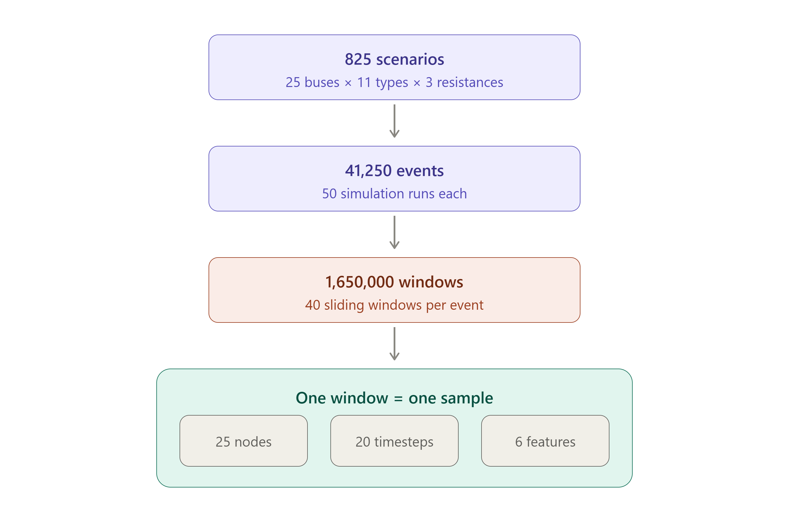

- **Feeder:** IEEE 123-bus, 4.16 kV, 60 Hz — **OpenDSS** (OpenDSSDirect.py), Daily mode, **1 ms** step.
- **Factorial design:** 25 fault buses × 11 fault types (3 LG, 3 LL, 3 LLG, 2 three-phase)
  × 3 fault resistances (0.1, 1, 10 Ω) = **825 scenarios**.
- **50 runs/scenario**, load multiplier ~ 𝒰(0.5, 1.3) per run → **41,250 events**.
- **Windowing:** 60 ms record (40 ms pre-fault, 20 ms fault), 20-step windows → **40 windows/event**
  → **1,650,000 windows** total. Exactly **50 % no-fault** by construction.
- **Split:** event-level **70/15/15** → train 1,155,000 / val 248,000 / test **247,000** windows
  (6,175 test events). **Verified 0 leakage** — no window of an event appears in two splits.
- One sample = tensor **[N=25 nodes, S=20 steps, F=6 features]**
  (3 RMS phase voltages + 3 availability-mask channels). **26 classes** = 25 buses + no-fault.

---

## Slide 6 — Graph Construction (Measured-Only Graph)

**Figure:** `paper/figures/measured_only_graph.png` — the real 25-node tree with actual IEEE-123 bus
numbers, coloured by 1-/2-/3-phase instrumentation, **red-ringed = also a fault location**
(count them on screen: exactly **6** — 13, 18, 25, 35, 47, 97).

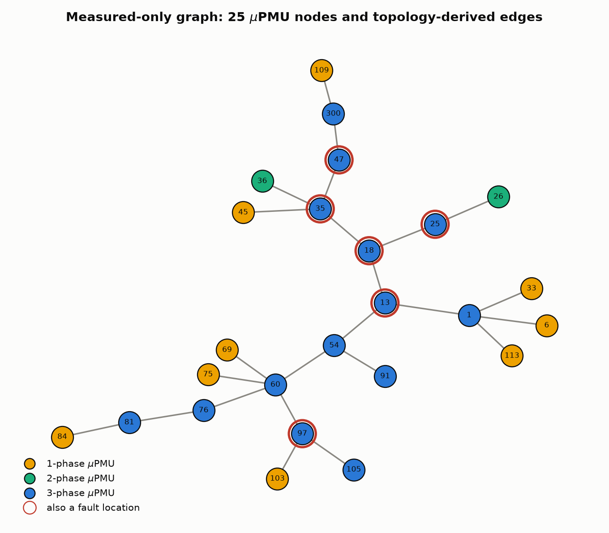

*Speaker note:* This is the single best slide for the "19 unmeasured fault buses" point — you can
point at the red rings and say "only these six are directly observed."

- Nodes = **25 μPMU buses only** (not all 123 buses).
- Edges built by a **substation-rooted spanning tree** over the measured set (Algorithm 1):
  two μPMUs are connected if the electrical path between them contains no other μPMU.
- Result: a **connected 25-node, 24-edge tree** — the graph is a topological abstraction of the
  feeder, so an unmeasured fault bus shows up as a *signature pattern across its measured neighbours*.
- **Mask channels are static, not all-ones:** only **14 of 25** μPMUs are three-phase; the rest show
  patterns like (1,0,0). They encode per-node phase instrumentation and never change over time.
  *(This detail turns out to be the mechanism behind our main result — see Slide 13.)*

---

## Slide 7 — Model Architecture (shared template)

**Figure: none that fits — use the ASCII block below as the slide graphic.**
⚠️ `sdr_architecture.png` looks like the right diagram but it is **SDR-STGNN-specific** (its middle
block is the red "Availability-Gated Message Passing"), so it belongs on slide 15, not here.
Showing it now would reveal the ablation before the baseline is established.

```
[N,S,6] ──► Temporal encoder: shared 1-layer GRU-128 (per node)
        ──► Spatial block: 4 × GNN layers  (the only variable across baselines)
        ──► Node head: BatchNorm → ReLU → dropout 0.35 → Linear(26)
        ──► Soft voting: sum of node softmax probabilities → argmax = event label
```

**Five baselines** (identical everywhere except the spatial block):
GRU (no graph), RGCN, RGSAGE-Mean, **RGSAGE-Max**, RGATv2.

- Training: 30 epochs, unweighted cross-entropy (corpus is balanced by design),
  gradient clipping 1.0, 3 warm-up epochs, **seeds 42/43/44** on every run.
- Hardware: single NVIDIA T1000 8 GB.
- **Deviation from the base paper:** spatial depth **4** (paper used 1) — depth-1 was unstable here.
  All deviations are tabulated in the paper (`tab:deviations`).

---

## Slide 8 — Result 1: Clean-Condition Benchmark (k = 0)

Soft-voted macro-F1 on the test set, **mean ± std over seeds 42/43/44**:

| Model | Event macro-F1 | Per-window F1 | F1 @ 0.1 Ω | F1 @ 1 Ω | F1 @ 10 Ω |
|---|---|---|---|---|---|
| GRU (no graph) | 0.286 ± 0.009 | 0.150 | 0.410 | 0.292 | 0.105 |
| RGATv2 | 0.522 ± 0.087 | 0.460 | 0.630 | 0.574 | 0.312 |
| RGCN | 0.712 ± 0.017 | 0.601 | 0.874 | 0.792 | 0.428 |
| RGSAGE-Mean | 0.786 ± 0.023 | 0.660 | 0.906 | 0.843 | 0.587 |
| **RGSAGE-Max** | **0.846 ± 0.007** | **0.718** | **0.949** | **0.893** | **0.676** |

**Takeaways**

- The graph matters: **+0.56 F1** from GRU → RGSAGE-Max. Topology is doing real work.
- **Max aggregation wins** — a fault is a *localized extremum*, and mean-pooling washes it out.
- Accuracy falls with fault resistance (0.949 → 0.676 at 10 Ω) — high-Z faults are the hard case.
- No-fault precision ≥ 0.97 and recall ≈ 1.00 for every model → **no false alarms**.
- Best-validation epoch was 27.7–28.7 of 30 for RGCN/RGSAGE-* → still improving; **report as a floor.**

**Figure:** `paper/figures/fault_signature.png` — voltage at fault inception (40 ms) for the three
fault resistances. This is *why* the 10 Ω column is hard: the sag is **0.83 p.u. at 0.1 Ω but only
0.01 p.u. at 10 Ω** — a high-Z fault barely moves the voltage.

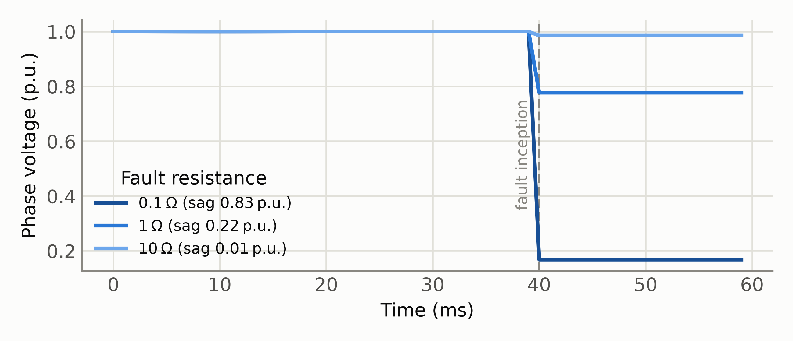

---

## Slide 9 — The Robustness Question & Evaluation Protocol

**Figure:** `paper/figures/sdr_protocol.png` — the same 25-node graph drawn five times, one per
*k*, with dropped μPMUs in red. Reads left-to-right as the stress sweep.

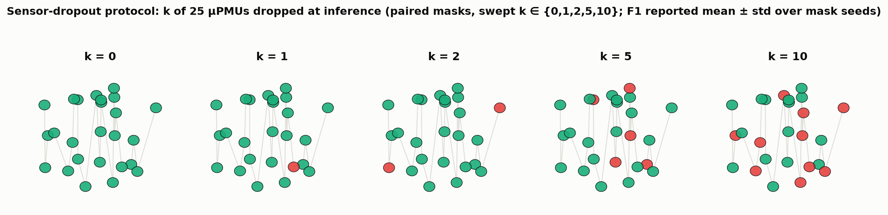

- At **inference only**, drop a uniformly random subset of *k* μPMU nodes: zero all 6 channels of
  each dropped node (`policy = zero_messages`). Training is untouched.
- *k* ∈ {0, 1, 2, 5, 10} out of 25 nodes (i.e. up to **40 % of the fleet offline**).
- **3 mask seeds × 3 training seeds** for every point; error bars = std across training seeds.
- Two summary metrics:
  - **AUDC** — normalized area under the degradation curve (1.0 = no degradation at all).
  - **Ret.@10** — F1 at k=10 as a fraction of F1 at k=0 (retention).
- *Bugfix note:* an earlier version reused one mask per batch; the mask seed is now derived from
  the batch index. All numbers here are post-fix (shifts in the 2nd–3rd decimal only).

---

## Slide 10 — Result 2: Everything Collapses

**Figure:** `paper/figures/sdr_heatmap.png` — model × k grid of macro-F1, green→yellow as sensors
are lost. The eye goes straight to the RGSAGE-Max row falling 0.85 → 0.05.

⚠️ **Cover the bottom row (SDR-STGNN) until slide 13** — the heatmap already contains the fix.
In PowerPoint: place a background-coloured rectangle over that row and remove it on slide 13,
or crop the image for this slide.
⚠️ Do **not** use `sdr_degradation_all.png` here — it also plots both mitigation curves and
gives away the result. It is the slide-13 figure.

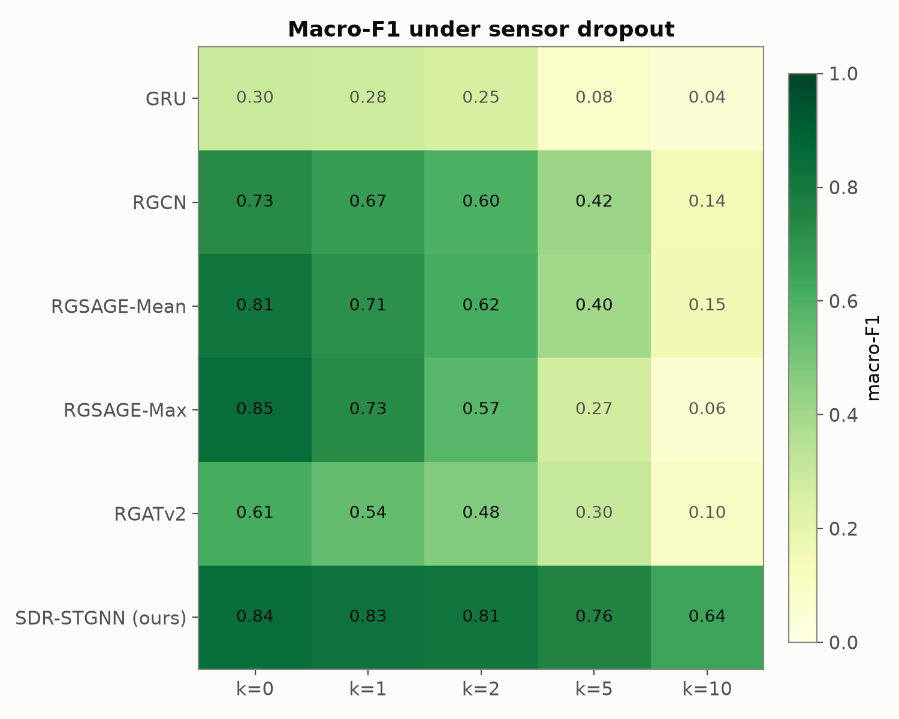

Macro-F1 of **standard-trained** models vs number of dropped μPMUs:

| Model | k=0 | k=1 | k=2 | k=5 | k=10 | Ret.@10 |
|---|---|---|---|---|---|---|
| **RGSAGE-Max** | 0.846 | 0.736 | 0.590 | 0.236 | **0.048** | **5.7 %** |
| RGSAGE-Mean | 0.786 | 0.720 | 0.647 | 0.393 | 0.108 | 13.8 % |
| RGCN | 0.712 | 0.664 | 0.610 | 0.418 | **0.164** | **23.1 %** |
| RGATv2 | 0.522 | 0.490 | 0.444 | 0.302 | 0.157 | 30.1 % |
| GRU | 0.286 | 0.273 | 0.252 | 0.111 | 0.051 | 17.9 % |

**The headline finding: an accuracy/robustness inversion.**
The **most accurate** model (RGSAGE-Max, 0.846) is the **most fragile** — it loses 94 % of its F1
at k=10, while the *less* accurate RGCN retains 3–4× more. Max-pooling concentrates the decision
on a few extremal nodes, so silencing them is catastrophic.

*Honesty caveat for the guide:* this inversion has the **same sign in all 3 seeds** but is
**not statistically significant** at n=3 (Δ=+0.116, p=0.076). We state it as an observed trend.

---

## Slide 11 — Why Naive Fixes Don't Help: Imputation Baseline

**Figure: none exists** — the imputation baseline has no plot in `paper/figures/`; it lives only in
`results/dropout_study_impute/imputation_summary.json`. Use the two-row table below, or see
*Missing figures* at the end for a 10-minute script that would generate one.

A reviewer-style question we answered: *why not just fill in the missing sensors?*

- **Neighbour-mean imputation:** each dropped node's 3 voltage channels ← per-timestep mean of its
  *available* 1-hop neighbours, and its mask is set to **1** (the most favourable setting for
  imputation). Fed to the **standard-trained** RGSAGE-Max.

| k | 0 | 1 | 2 | 5 | 10 |
|---|---|---|---|---|---|
| Zeroing | 0.846 | 0.736 | 0.590 | 0.236 | 0.048 |
| **Imputation** | 0.846 | 0.739 | 0.637 | 0.336 | **0.099** |

- AUDC 0.402 → **0.476**; Ret.@10 5.7 % → **11.8 %**.
- **It barely helps** (the gain at k=10, +0.051, is *not* significant, p=0.102).
- **Why:** the reconstructed values still go to a model that was **never trained to distrust them**.
  Signal reconstruction is not the bottleneck — the model's *trust calibration* is.

---

## Slide 12 — Contribution 1: Dropout-Aware Training

**Figure: none — use the pseudocode block as the slide graphic.**
⚠️ `sdr_mechanism.png` is *not* about dropout-aware training: it shows the **availability gate**
(standard aggregation vs. blocked message from a dead sensor). It belongs on slide 15.

**The idea (deliberately simple):** apply the *same* random sensor-dropout masking **during
training**, sampling *k* per batch. Nothing else changes — same architecture, same loss,
same hyper-parameters.

```
for each training batch:
    k  ~ U{0..k_max}
    S  ~ random subset of k nodes
    zero all 6 channels of nodes in S
    forward / backward as usual
```

- **Architecture-agnostic:** it is a data augmentation, not a model change.
- **Zero inference cost:** identical parameter count (95,258) and identical latency
  (0.639 vs 0.640 ms @ B=1; 6,038 windows/s both) — **measured**, not asserted.
- Only cost: **+2.7 %** training seconds/epoch.

---

## Slide 13 — Result 3: Dropout-Aware Training Works

**Figure (the money slide):** `paper/figures/sdr_degradation_all.png` — all 5 standard baselines
diving toward the floor, with the two flat mitigation curves riding along the top. One image
carries the whole paper.

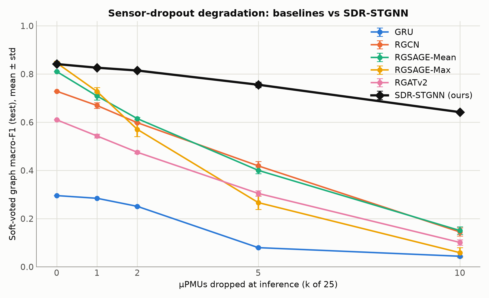

**Supporting:** `sdr_retention.png` (% of clean F1 retained — the 80 % vs 6 % gap at k=10) and
`sdr_audc_bar.png` (three bars: 0.402 / 0.913 / 0.892, values printed on the bars).

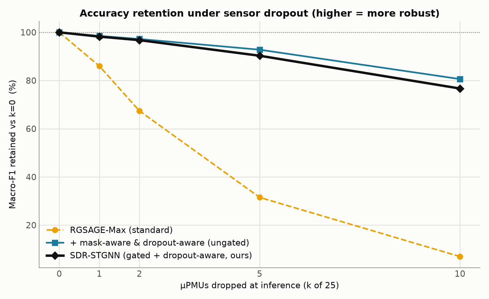

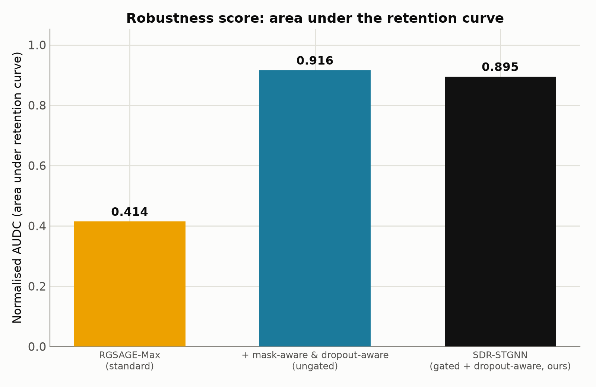

RGSAGE-Max backbone, 3 training seeds × 3 mask seeds:

| Variant | AUDC | k=0 | k=1 | k=2 | k=5 | k=10 | Ret.@10 |
|---|---|---|---|---|---|---|---|
| Standard | 0.402 | 0.846 | 0.736 | 0.590 | 0.236 | 0.048 | 5.7 % |
| + neighbour-mean imputation | 0.476 | 0.846 | 0.739 | 0.637 | 0.336 | 0.099 | 11.8 % |
| **+ dropout-aware training** | **0.913** | 0.839 | 0.827 | 0.815 | 0.774 | **0.674** | **80.3 %** |
| SDR-STGNN (gated, ours) | 0.892 | 0.839 | 0.827 | 0.813 | 0.758 | 0.632 | 75.2 % |

- **Retention 5.7 % → 80.3 %** at 10 of 25 sensors lost. **AUDC 0.402 → 0.913.**
- **Clean accuracy is essentially free:** 0.846 → 0.839, i.e. **−0.008, p = 0.181 (not significant).**
- **Why it works (the mask mechanism):** dropping a node zeroes its mask to (0,0,0) — a pattern
  that node **never** exhibits in standard training, so the network is off-distribution. Dropout-aware
  training puts (0,0,0) *in* the training distribution and the model learns to route around it.

---

## Slide 14 — Result 4: It Generalizes Across All Five Architectures

**Figure: none exists** — no plot compares standard vs dropout-aware across all 5 architectures.
The table below is the deliverable; a grouped bar chart would be a nice-to-have (see
*Missing figures*).

AUDC, standard → dropout-aware:

| Model | AUDC standard → aware | ΔAUDC | F1 @ k=10 standard → aware |
|---|---|---|---|
| GRU (no graph) | 0.521 → 0.784 | +0.263 | 0.051 → 0.078 |
| RGCN | 0.607 → **0.940** | +0.333 | 0.164 → **0.533** |
| RGSAGE-Mean | 0.540 → **0.921** | +0.381 | 0.108 → **0.550** |
| **RGSAGE-Max** | 0.402 → **0.913** | **+0.511** | 0.048 → **0.674** |
| RGATv2 | 0.621 → **0.960** | +0.339 | 0.157 → **0.505** |

- The AUDC gain is **statistically significant for all 5 architectures** (p_Holm ≤ 0.027).
- The **graph-based** models benefit most — they have neighbours to route through; the graph-free
  GRU has nowhere to route (0.078 at k=10), confirming the mechanism is *spatial redundancy*.
- After dropout-aware training the curves **flatten**: RGSAGE-Max loses only 0.165 F1 across
  k = 0 → 10, versus 0.798 for the standard model.

---

## Slide 15 — Contribution 2 (Ablation): SDR-STGNN — an Honest Negative Result

**Figure 1 — the mechanism:** `paper/figures/sdr_mechanism.png` — side-by-side of standard
aggregation (dead red sensor still sends a message into node *j*) vs the gate (that message is
blocked, dashed). This is the clearest one-glance explanation of the gate.

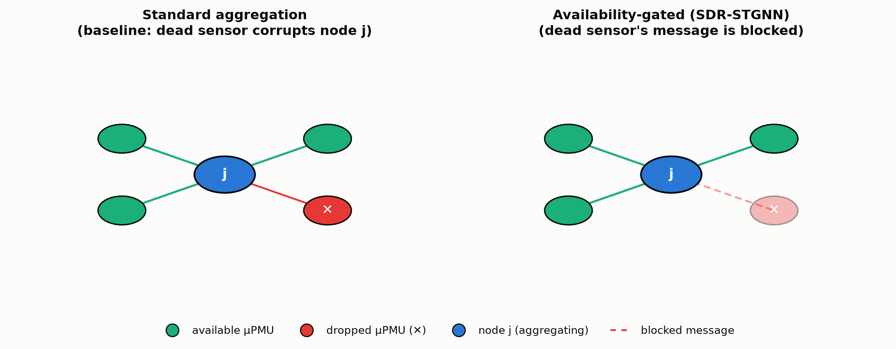

**Figure 2 — the block diagram:** `paper/figures/sdr_architecture.png` — full pipeline with the
red availability-gated message-passing block and the `a ∈ {0,1}^N` availability input.

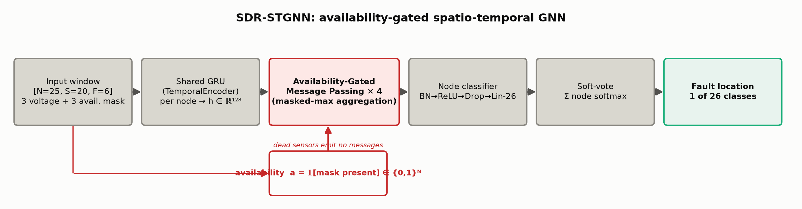

**Figure 3 — the result:** `paper/figures/sdr_ablation_backbone.png` — three curves on the
RGSAGE-Max backbone; the blue (ungated) and black (gated) lines sit on top of each other, which
*is* the finding.
⚠️ Check before using: the title text appears **clipped at both edges** in this PNG
(regenerate with `bbox_inches="tight"` if you want the full title).

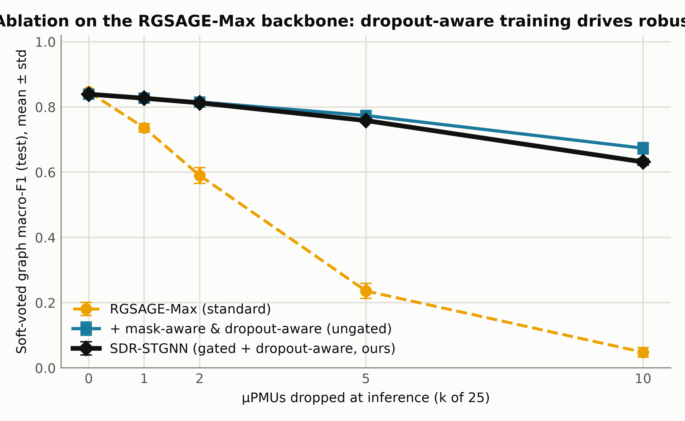

**Design:** RGSAGE-Max + **availability-gated aggregation** — dropped nodes emit **no messages**,
with the gate keyed on *original* availability at **every hop**. At k=0 it is exactly RGSAGE-Max.

**Result: it matches but does not beat dropout-aware training.**

- AUDC **0.892** vs **0.913**; Ret.@10 **75.2 %** vs **80.3 %** (Δ AUDC = +0.021 for DA, p = 0.098
  → statistically a **tie**).
- And it **costs more**: **+18 % inference latency** (0.755 vs 0.639 ms) for 0 extra parameters.

**Why the gate loses:** silencing a dropped node at *every* hop also blocks **multi-hop routing
through it** — information that could have been relayed from a healthy 2-hop neighbour is
destroyed. The ungated model can still reconstruct via longer paths.

> We report this faithfully as an ablation. **We do not claim the gate wins.**

---

## Slide 16 — Stress-Testing the Mitigation: Worst-Case and Realistic Failures

Random dropout is the *average* case. Two harder settings, both on RGSAGE-Max, seeds 42/43/44:

**(a) Targeted dropout — the worst case.** Drop the k μPMUs *nearest the fault bus* (hop distance
on the full 123-bus topology). Deterministic given the label, so there are no mask seeds.

| Variant | k=0 | k=1 | k=2 | k=5 | k=10 |
|---|---|---|---|---|---|
| Standard, **targeted** | 0.846 | **0.448 ± 0.039** | 0.361 | 0.206 | 0.048 |
| Standard, random (reference) | 0.846 | 0.736 ± 0.013 | 0.590 | 0.236 | 0.048 |
| **Dropout-aware, targeted** | 0.839 | 0.755 | 0.695 | 0.600 | **0.521** |

- Targeting hurts **exactly where the model is still usable**: at k=1 the standard model falls
  **3.6× further** than under random loss (p=0.010). By k≥5 the policies agree — it has collapsed
  either way.
- **Dropout-aware training is penalized too** (AUDC 0.913 → **0.747**, p=0.003). Worst-case loss
  is a *distinct stressor*, not one the mitigation absorbs — say this plainly.
- But it still transfers to a failure mode it was never trained on: from k=2 up, its
  **worst-case** score beats the standard model's **average-case** score (0.695 vs 0.590,
  p=0.042). At k=1 the two are indistinguishable (+0.018, p=0.33) — no win claimed there.

**(b) Persistent dropout — the realistic case.** A real μPMU stays dark for the whole event, so
draw the dropped set once per event and hold it across all 40 windows.

> **Result: nothing moves.** No point shifts by more than **0.003** macro-F1; no difference
> survives Holm (min p_Holm = 0.46).

**Why it's a null, and why that's interesting:** our decision rule is *per window* — soft voting
pools the 25 nodes of one window, never the 40 windows of an event. So a window's prediction
depends only on its own mask, whose marginal distribution is identical either way.
⚠️ **This equivalence would NOT hold for an event-level rule** — per-window resampling would
flatter that by giving it 40 differently-masked views of a failure that presents only once.
Good pre-empt for a sharp guide question.

*Figure: none — both are tables. Source: `results/dropout_study_{targeted,persistent}/`.*

---

## Slide 17 — Statistical Validation & Cost

**Significance** (paired two-sided t-tests over seeds 42/43/44, n=3, Holm–Bonferroni per family;
plus a paired **cluster bootstrap over the 6,175 test events** at k=0):

| Claim | Δ | p_Holm | Verdict |
|---|---|---|---|
| Dropout-aware > standard @ k=10 | +0.626 | 0.003 | ✅ significant |
| Retention @10 gain | +74.6 pp | 0.003 | ✅ |
| AUDC gain | +0.511 | 0.003 | ✅ |
| Dropout-aware > imputation @ k=10 | +0.574 | 0.008 | ✅ |
| Clean-F1 cost of dropout-aware | −0.008 | 0.196 | ✅ null, as claimed |
| DA over SDR-STGNN (AUDC) | +0.021 | 0.196 | ⟺ statistical tie |
| Accuracy/robustness inversion | +0.116 | — (p=0.076) | ⚠️ trend only |

**Cost (measured, `results/runtime/`):** dropout-aware = identical params & latency, +2.7 % train
time. SDR gate = +18 % latency, no gain. Activation memory 145 MiB for *all* models (the shared
GRU-128 encoder dominates). Training ≈ 4.7–12.3 GPU-hours per run on a T1000.

---

## Slide 18 — Discussion: What a Utility Should Take Away

1. **Do not pick an architecture on clean accuracy alone.** The best clean model was the worst
   under sensor loss. Robustness must be a reported axis.
2. **Dropout-aware training is the recommended mitigation** — one line in the data pipeline,
   free at inference, works on every architecture we tried, statistically validated.
3. **Don't reach for imputation first.** Reconstructing the missing signal is far less effective
   than teaching the model to operate without it.
4. **Architectural gating is not required** — and here it actively costs latency for no gain.

5. **Robustness gained is not robustness everywhere.** Dropout-aware training was trained on
   random loss, yet still transfers to targeted and persistent failures — but targeting *does*
   erode it (AUDC 0.913 → 0.747). Don't sell it as universal.

**Limitations (stated in the paper):**
single feeder (IEEE-123), simulation-only (no real μPMU noise/latency), n=3 seeds limits the power
of the weaker claims, 30-epoch budget means accuracies are a floor, targeted/persistent dropout
measured on **one backbone only** (RGSAGE-Max), spatially-correlated failures (a comms hub taking
out a whole region) still untested, and the green-feeder reconfiguration scenario was
**cut as out of scope**.

---

## Slide 19 — Status & Next Steps

**Done**
- Full 50-run corpus (1.65 M windows) generated and frozen; 0 leakage verified.
- All 5 baselines × 3 seeds; all dropout-aware variants × 3 seeds; SDR-STGNN × 3 seeds.
- 3-seed degradation curves, imputation baseline, significance tests, runtime benchmark.
- **Targeted (worst-case) and persistent (per-event) dropout studies** — both in the paper.
- Paper is a **complete draft** — abstract → conclusion + bibliography, all figures/tables generated.

**Remaining before submission**
- **Page count: 13 pp vs the 12-page ICMLDE cap** — trimming is the live task.
- iThenticate / similarity check.

**Future work**
- **Spatially correlated** failures (one comms hub taking out a contiguous region) — the one
  dropout geometry not yet tested; targeted and persistent are done.
- Targeted/persistent dropout on the **other four architectures** (measured on RGSAGE-Max only).
- The staged **100-run corpus (3.30 M windows)** sweep — code ready, not launched.
- Real μPMU field data; feeder reconfiguration as a second stress axis; adaptive gating.

---

## Slide 20 — Conclusion

- We adopt an STGNN fault-localization protocol on IEEE-123 under partial observability and
  report our own 3-seed benchmark — **RGSAGE-Max reaches 0.846 macro-F1**.
- We show that **standard STGNNs collapse under sensor dropout** (0.846 → 0.048, 5.7 % retention),
  and that the **most accurate architecture is the most fragile**.
- We propose **dropout-aware training**: **80.3 % retention** at 40 % sensor loss,
  **zero inference cost**, **no significant clean-accuracy penalty**, effective on **all five**
  architectures (p_Holm ≤ 0.027).
- We ablate an availability-gated architecture (**SDR-STGNN**) and report honestly that it
  **matches but does not beat** the training-side fix, at +18 % latency.

---

## Backup Slides / Anticipated Guide Questions

**Q. Is this a reproduction of Karabulut et al.?**
No — and we are explicit about it in the paper. We **adopt the methodology** and report **our own**
numbers. Our corpus (1.65 M windows) is not reconstructable to their reported 2.5 M from the 825
scenario grid, and we use depth 4 instead of 1. All deviations are tabulated (`tab:deviations`).
We make **no numeric-replication claim**.

**Q. Why is the corpus balanced 50/50 and why unweighted CE?**
The balance is by factorial construction (pre-fault + fault windows), and the 25 fault classes are
equal by design. Imbalance is handled by the **corpus**, not by loss weighting — `train.py` passes
no class weights. This is stated in the paper.

**Q. Isn't dropout-aware training just standard dropout?**
No. Standard dropout zeroes random *activations* inside the network. This zeroes **entire sensor
nodes' input channels**, matching the deployment failure mode exactly — including the mask channels,
which is what makes the OOD pattern learnable.

**Q. Why does k=10 mean 40 %?**
The graph has 25 μPMU nodes; k=10 dropped = 40 % of the sensing fleet offline simultaneously.

**Q. Is k=10 realistic?**
It's a stress test, not an expected operating point. The curve is reported at k = 0,1,2,5,10 so a
utility can read off its own risk level; even at k=1–2 the standard model already loses 0.11–0.26 F1.

**Q. Why only 3 seeds?**
Each run is 4.7–12.3 GPU-hours on a single T1000; 3 seeds × 5 architectures × 3 variants was the
compute budget. We are careful to mark which claims survive n=3 (the mitigation claims do) and
which do not (the architecture ranking and the inversion).

**Q. What if the sensors that fail are the ones that mattered — near the fault?**
We measured exactly that (slide 16). Targeted dropout is much worse at low k: the standard model
falls to 0.448 at k=1 instead of 0.736. Dropout-aware training is penalized too (AUDC 0.913 →
0.747), so it does not absorb the worst case — but from k=2 up its worst-case score still beats
the standard model's average-case score.

**Q. Real sensors stay dead — doesn't redrawing the mask every window flatter your numbers?**
Also measured (slide 16). Holding the mask for a whole event changes nothing (< 0.003 macro-F1,
min p_Holm = 0.46), because our decision rule is per-window: soft voting pools the 25 nodes of
one window, never the 40 windows of an event. We flag in the paper that this equivalence would
**not** hold for an event-level rule.

**Q. What if a whole substation region drops out?**
That is *spatially correlated* dropout, and it is the one geometry we have **not** tested — our
random and targeted policies both select nodes independently of each other. It's the top
future-work item.

---

## Figure Inventory — verified by inspection

Every file below was opened and checked; the "Shows" column describes the actual image content,
not the filename. All live in `paper/figures/` and export at 400 dpi.

| Slide | File | Shows (verified) |
|---|---|---|
| 5 | `stgnn_dataset_size_breakdown.png` | 4-box flow: 825 scenarios → 41,250 events → 1,650,000 windows → 25×20×6 sample |
| 6 | `measured_only_graph.png` | Real 25-node tree, IEEE-123 bus numbers, 1/2/3-phase colour coding, 6 red-ringed fault buses |
| 8 | `fault_signature.png` | Voltage vs time at inception for 0.1/1/10 Ω — sag 0.83 → 0.22 → 0.01 p.u. |
| 9 | `sdr_protocol.png` | The graph drawn 5× (k=0,1,2,5,10) with dropped nodes in red |
| 10 | `sdr_heatmap.png` | Model × k macro-F1 grid (6 rows incl. SDR — **mask the last row** on this slide) |
| 13 | `sdr_degradation_all.png` | All 5 baselines collapsing + both mitigation curves flat on top |
| 13 | `sdr_retention.png` | % of clean F1 retained vs k — 80 % / 75 % vs 6 % |
| 13 | `sdr_audc_bar.png` | 3 bars, values printed: 0.402 / 0.913 / 0.892 |
| 15 | `sdr_mechanism.png` | Standard vs gated aggregation — dead sensor's message blocked |
| 15 | `sdr_architecture.png` | SDR-STGNN block diagram with the availability input |
| 15 | `sdr_ablation_backbone.png` | 3 curves on RGSAGE-Max; gated and ungated overlap |

**Corrections applied to an earlier draft of this deck** (the filenames were misleading):
`sdr_mechanism.png` is the *gate*, not the mask/OOD argument → moved 12 → 15.
`sdr_architecture.png` is *SDR-specific*, not the shared template → moved 7 → 15.
`sdr_heatmap.png` is *standard models + SDR*, not standard-vs-aware → moved 14 → 10.
`sdr_degradation_all.png` already contains the mitigations → moved 10 → 13.

*Never use the `*.prebugfix.png` variants — they predate the mask-diversity bugfix.*
`Screenshot 2026-08-03 112448.png` is also in the folder; it is not a paper figure — ignore it.

---

## Missing Figures (slides 11, 12, 14)

Three slides have no matching figure on disk. None of them blocks the review — each has a table or
a pseudocode block that carries the point — but if you want full visual coverage:

| Slide | What's missing | Source data | Effort |
|---|---|---|---|
| 11 | Imputation vs zeroing curve (2 lines vs k) | `results/dropout_study_impute/imputation_summary.json` | ~10 min plotting script |
| 12 | Dropout-aware training schematic (batch → random node mask → forward) | none needed — hand-drawn | draw in PowerPoint |
| 14 | Grouped bars: AUDC standard vs aware × 5 architectures | `results/dropout_study{,_aware}/degradation_curves.csv` | ~15 min plotting script |
| 16 | Targeted vs random curves (the k=1 gap is the visual) | `results/dropout_study_targeted/targeted_curves_*.csv` | ~10 min plotting script |

**My recommendation:** build #11, #14, and #16 — they turn three text-heavy slides into visual
ones, and all three read straight off CSV/JSON already on disk. #12 is better hand-drawn in the
slide editor than generated. Say the word and I'll write the scripts and generate the PNGs at
400 dpi to match the existing figures.
