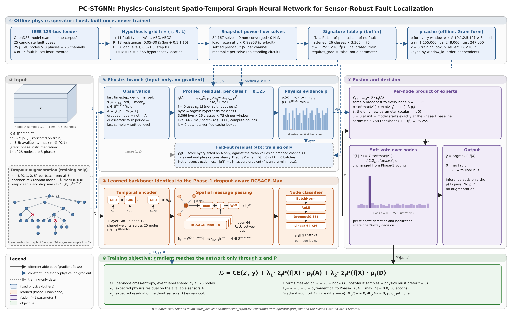
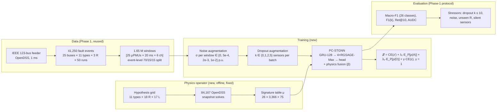

# Proposed Methodology: PC-STGNN (Physics-Consistent Spatio-Temporal GNN)

Content for the review rubric item **"Proposed Methodology (algorithm, architecture, block
diagram)"**. Every element described here is implemented and tested in `fault_localization/`.
Numbers come from the code, `operator/grid.json` and the closed gate records in `PC-STGNN/`.
**Last updated 2026-10-05:** adds the auxiliary network-only loss (γ = 1, S4.3ᵈ) to the method.

---

## 1. One-slide version (put this on the slide)

**Idea in one line.** Keep the Phase-1 dropout-aware STGNN exactly as it is. Add a **fixed**
physics operator, a table of fault voltage signatures solved in OpenDSS. Then use how well the
measurements match each candidate fault (the residual ρ):
- as **evidence at inference**: a per-node product of experts
- as a **consistency loss in training**: the λ₁ and λ₂ terms

An **auxiliary cross-entropy on the network-only logits** (weight γ = 1, fixed) makes the network
branch localize on its own, so it cannot hand the whole task to physics.

The physics adds **one** learned scalar, β. The auxiliary loss adds none.

**Figure:** the full architecture, [paper/figures/pcstgnn_architecture.png](paper/figures/pcstgnn_architecture.png)
(vector version: `.svg` in the same folder).
> **⚠ The rendered figure predates the γ term**: its loss box shows CE + λ₁ + λ₂ only. Regenerate
> it (`scripts/build_pcstgnn_arch_figure.py`) or add `+ γ·CE(z, y)` on the slide.



**Three equations to show on the slide:**

```
Physics evidence:  ρ_f(A) = ½ [ r_f(A) − min_f′ r_f′(A) ],
                   r_f(A) = min_(τ,R,L) Σ_(i,p)∈A (s_ip − μ_f,τ,R,L,i,p)² / (σ_ε² + σ₀²)

Fusion:            z′_n,f = z_n,f − β·ρ_f(A),      P(f|X) ∝ Σ_n softmax(z′_n)_f

Training loss:     ℒ = CE(z′, y) + λ₁·Σ_f P(f|X)·ρ_f(A) + λ₂·Σ_f P(f|X)·ρ_f(D) + γ·CE(z, y)
```

**Symbols** (use them in the speaker notes):

| Symbol | Meaning |
|---|---|
| s | measured voltage magnitudes in p.u. |
| A | the sensors available in this window |
| D | the sensors dropped during training |
| μ | the signature table |
| (τ, R, L) | fault type, fault resistance, load level |
| z | the network's per-node logits |
| P | the soft-voted class probabilities |
| γ | weight of the auxiliary loss on the network-only logits z (fixed at 1) |

---

## 2. Block diagram: end-to-end pipeline



---

## 3. Architecture: component specification

| Block | Specification | Output shape | Learned? |
|---|---|---|---|
| Input | 3 RMS voltage magnitudes per phase (z-scored on the train split) + 3 availability-mask channels, 20 samples at 1 ms | `X ∈ ℝ^(B×25×20×6)` | — |
| Temporal encoder | 1-layer GRU, hidden 128, weights shared across the 25 nodes | `ℝ^(B×25×128)` | yes |
| Spatial block | 4 × RGSAGE-Max layers, hidden 64, ReLU between layers: `h_i ← W[h_i ‖ max_(j∈N(i)) h_j]`. Measured-only graph: 25 nodes, 24 edges (spanning tree) | `ℝ^(B×25×64)` | yes |
| Node classifier | BatchNorm → ReLU → Dropout(0.35) → Linear 64→26 | `z ∈ ℝ^(B×25×26)` | yes |
| Observation | last timestep, de-normalised to p.u.; available set `A = {(i,p) : m_ip = 1}` | `s ∈ ℝ^(B×25×3)` | no |
| Physics residual | profiled minimum over 3,366 (τ, R, L) hypotheses per class, 26 classes (class 0 uses the no-fault table μ₀); σ_ε = 7.2555e-4 p.u. | `ρ ∈ ℝ^(B×26)` | no (a buffer) |
| Fusion | `z′_n,f = z_n,f − β·ρ_f(A)`, the same ρ broadcast to every node | `ℝ^(B×25×26)` | **β only** (init 0) |
| Soft vote | `P(f|X) = Σ_n softmax(z′_n)_f`, normalised over f | `ℝ^(B×26)` | no |
| Decision | `ŷ = argmax_f P(f|X)`; 0 = no fault, 1…25 = faulted bus | `ℝ^B` | — |

**Parameters:** 95,258 in the Phase-1 backbone, plus 1 (β), for **95,259** in total. The
signature table, μ₀ and σ_ε are registered buffers that receive no gradient (verified in S4.2).
The auxiliary loss reuses the classifier's own logits z, so it adds no parameters.

---

## 4. Algorithms

### Algorithm 1: Offline physics operator (run once)

```
Input : IEEE 123-bus OpenDSS model; fault buses F (25), types T (11),
        resistance grid R (18 values, 0.05–30 Ω, includes 0.1, 1, 10),
        load grid L (17 values, 0.5–1.3, step 0.05)
Output: signature table μ[f, τ, R, L, i, p], no-fault table μ₀[L, i, p], floor σ_ε

1  for each (f, τ, R, L) in F × T × R × L:
2      set the global load multiplier to L × 0.99953        ▷ frozen pre-fault level
3      apply fault (f, τ, R); solve the power flow (recompile per solve)
4      μ[f, τ, R, L, :, :] ← settled |V| at the 25 µPMU nodes × 3 phases (p.u.)
5  for each L in L:  μ₀[L, :, :] ← no-fault |V| at load L
6  calibrate σ_ε on the TRAIN split so the median residual at the true class ≈ 1
                                                         ▷ σ_ε = 7.2555e-4 p.u.
7  flatten to 26 classes × 3,366 hypotheses × 75 channels
   ▷ measured: 84,167 solves, 0 non-converged, 0 NaN; Gate 1 passed 5/5
```

### Algorithm 2: Physics residual ρ (a function of the input only)

```
Input : batch X, table μ (26 × H × 75), floor σ_ε, per-window noise level σ₀ ∈ ℝ^B
Output: ρ ∈ ℝ^(B×26), best hypothesis per class hyp* ∈ ℕ^(B×26)

1  s ← X[:, :, last timestep, 0:3] · std + mean           ▷ back to per-unit
2  a ← (X[:, :, last timestep, 3:6] > 0.5)                ▷ available channels A
3  w ← a / (σ_ε² + σ₀²)                                   ▷ per-window weights
4  for each class f:
5      r_f ← min over h of Σ_c w_c · (s_c − μ[f, h, c])²   ▷ profile (τ, R, L)
6      hyp*_f ← argmin over h
7  ρ_f ← ½ (r_f − min_f′ r_f′)                            ▷ shift and halve; best class = 0
8  return ρ, hyp*                                         ▷ computed under no_grad
```

### Algorithm 3: PC-STGNN training (one epoch)

```
Input : train loader, model θ (backbone + β), λ₁, λ₂, γ = 1, noise grid Σ = {0, 5e-4, 2e-3, 1e-2},
        dropout levels K = {0, 1, 2, 5}
Hyper : AdamW (lr 1e-3, weight decay 1e-4), batch 32, gradient clip 1.0, 3 warm-up epochs

 1  for each batch (X, y, window_ids):
 2      σ₀[b] ~ Uniform(Σ) for each window b                  ▷ noise augmentation
 3      X_n ← X + N(0, σ₀[b]²/std²) on available voltage channels only
 4      k ~ Uniform(K)                                         ▷ dropout augmentation
 5      X̃ ← X_n with all 6 channels of k random nodes zeroed;  D ← dropped channels
 6      z ← Backbone_θ(X̃)                                      ▷ GRU → 4×RGSAGE-Max → head
 7      ρ_A, hyp* ← Residual(X̃, σ₀)                            ▷ Algorithm 2
 8      z′ ← z − β·ρ_A                                         ▷ per-node product of experts
 9      P ← normalise(Σ_n softmax(z′_n))                        ▷ soft vote
10      ρ_D ← score hyp* (fitted on A only) on channels D of X_n  ▷ leave-k-out; 0 if |D| = 0
11      m ← 0 for windows with no post-fault sample (w = 20), else 1
12      ℒ ← CE(z′, y) + λ₁·mean_m(Σ_f P_f ρ_A,f) + λ₂·mean_m(Σ_f P_f ρ_D,f)
              + γ·CE(z, y)                                  ▷ auxiliary loss on network-only logits
13      θ ← AdamW step on ∇_θ ℒ (clipped)                       ▷ gradient flows via z and P only
14  checkpoint ← epoch with the best validation F1 at k = 0     ▷ Phase-1 rule
15  (fusion runs) abort if, after epoch 3, network-only F1 ≤ 0.10 or > 95 % "no fault"  ▷ collapse guard
```

### Algorithm 4: Inference

```
1  z ← Backbone_θ(X);   ρ_A ← Residual(X, σ₀)       ▷ no augmentation, no ρ(D)
2  P ← normalise(Σ_n softmax(z − β·ρ_A));   ŷ ← argmax_f P_f
```

### Algorithm 5: Research procedure (stage-gated)

```
Stage A  audit Phase-1 assets            → G0  reproduce Phase 1 exactly at k = 0          ✅
Stage B  build and validate the operator → G1  fidelity (τ* 90.9 %, L* 97.3 %, 5/5)       ✅
Stage C  training-free go/no-go          → G2  does physics add information? GO           ✅
Stage D  injectors, baselines, cache     → G3  infrastructure correct (5/5)               ✅
Stage E  train PC-STGNN                  → G4  beat the noise-augmented reference R0ⁿ     🔶
           S4.1 null test ✅ · S4.2 gradient audit ✅ · S4.3 tuning ✅ (collapse found)
           S4.3ᶜ noise diagnostic ✅ (unresolved) · S4.3ᵈ auxiliary loss ✅ (fixed)
           S4.3ᵉ noise-augmented λ re-tuning ✅ done (2026-10-08: selected λ₁=0, λ₂=0.1)
           S4.4 core ablation (Gate 4) 🔶 running (started 2026-10-09, amended to 30 epochs
           and restarted 2026-10-12; 3 of 6 Gate-4 runs complete as of 2026-10-15)
Stage F  trust gate for silent sensors   → G5                                             ⏳
Stage G  full evaluation, OOD, model mismatch                                             ⏳
Rule: cheap, training-free checks first; one variable at a time; selection never uses the test split
      (tuning runs never load it: skip_test_eval).
```

---

## 5. Design guarantees (each verified, not assumed)

| Guarantee | How it was verified |
|---|---|
| **Neutral when switched off:** λ₁ = λ₂ = β = 0 is exactly Phase 1 | S4.1: all 30 epochs byte-identical to the Phase-1 run (max \|Δ\| = 0.0) |
| **Auxiliary loss neutral when off:** γ = 0 is exactly the old objective | S4.3ᵈ null test: same total loss (difference 0) and identical gradients on all 17 parameter tensors, fixed seed-42 batch |
| **Physics losses actually train the network** | S4.2: finite-difference gradient audit on 3 targeted batches, 12/12 checks |
| **Physics is constant, never learned** | μ, μ₀ and σ_ε are buffers with `requires_grad = False`, absent from `parameters()` |
| **No label leakage** | ρ reads the input tensor only (no label, window index, R, type or load). On windows with no post-fault sample, models score at chance |
| **No capacity confound** | +1 parameter (β); γ adds none. Shuffled-physics (R6) and wider-backbone (R7) arms are planned in S4.4 |
| **Noise handled consistently** | σ₀ in the residual = the σ injected into each window. Tests show noise never touches mask channels and does not change the dropout masks |

---

## 6. Why noise augmentation is part of the method

- Trained **noise-free**, all 6 tuning runs reached a degenerate solution. Measured on the full validation split:
  - The network branch alone votes "no fault" on **99.9–100 %** of windows (F1 0.0256, the trivial score)
  - On fault windows the fused model matches physics-only PSM **95.9 %** of the time
- The reason: on noise-free data the residual at the true fault is exactly zero, so trusting physics completely is the easiest solution, and the network learns nothing
- Training under realistic µPMU noise (up to the IEEE C37.118 1 % limit) gives the physics term an imperfect confidence. That leaves the network something to learn
- **Noise was necessary but not sufficient (S4.3ᶜ, 5 epochs).** It removed the "no fault" bias (network "no fault" share ≈ 55 %, close to the true 50 %), but the network still left localization to physics: network-only F1 0.078 (λ₁ = 0) and 0.061 (λ₁ = 0.0333), below the 0.10 bar
- An arm that still collapses is **excluded from selection** by the pre-registered collapse guard: network-only F1 ≤ 0.10 or > 95 % "no fault"

## 7. Why the auxiliary network-only loss is part of the method

- **The loss:** γ·CE(z, y) on the network's own logits before fusion, from the same forward pass, with the same labels and unweighted cross-entropy as the main loss. γ = 1
- **Result (S4.3ᵈ, 5 epochs, noise on, λ₁ = λ₂ = 0, full validation split, k = 0, epoch 5):**

| | Fused F1 | Network-only F1 | Network-only F1 at σ = 1e-2 | Network "no fault" | β |
|---|---|---|---|---|---|
| Without γ (S4.3ᶜ) | 0.879 | 0.078 | 0.064 | 54.5 % | 0.035 |
| **With γ = 1 (S4.3ᵈ)** | **0.879** | **0.571** | **0.512** | **53.5 %** | **0.025** |

- The network branch now localizes on its own (7.3× the network-only F1), and the fused F1 is unchanged
- **γ = 1 is fixed, not tuned.** Every PC-STGNN arm in the S4.4 ablation uses it
- **[Result, 2026-10-08] S4.3ᵉ** re-tuned λ₁ ∈ {0, 0.01, 0.0333, 0.1} (λ₂ = 0, then λ₂ = 0.1 at the
  best λ₁) under these settings: 15 epochs, seed 42, validation only, pre-registered in commit
  `272ba01`. **Selected λ₁ = 0, λ₂ = 0.1** (best validation fused F1 averaged over k: 0.8797 vs
  0.8778 for λ₁=λ₂=0). λ₁ hurt monotonically at every value tried — the physics-consistency loss
  λ₁ did not contribute; λ₂ was neutral to slightly positive. Full table:
  `PC-STGNN/06_STAGE_E_pcstgnn.md` S4.3ᵉ. **[Correction, 2026-10-15]** This superseded the
  "no results yet" note below; S4.4 (Gate 4) is now training on the selected checkpoint.
