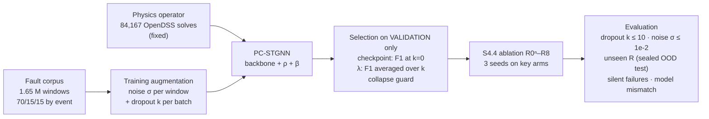

# Phase-2 Review — Slide Content, Figures, and Speaker Notes

**Project:** Physics-Consistent Spatio-Temporal GNN (PC-STGNN) for Sensor-Robust Fault Localization
**Prepared:** 5 Oct 2026, from `PPT2/Fault-main.pdf` (Phase-1 paper), `PC-STGNN/*.md` (Phase-2
spec and gate records), `results/` and `paper/figures/`.

**[Correction, 2026-10-15]** S4.3ᵉ (the re-tuning this document describes as running) finished
2026-10-08, selecting λ₁=0, λ₂=0.1. S4.4/Gate 4 training then started 2026-10-09, was amended to
30 epochs on 2026-10-12, and is now running (3 of 6 runs complete). Fixed inline below at
Section A, Slide 18, Slide 19, Section E and Section F; the rest of this document (Phase-1
recap, architecture, datasets, figures) is unaffected.

**Rules this document follows**
- Every number comes from a file in the repo; the source is given where it matters.
- **Implemented ≠ trained ≠ validated.** Anything not finished is marked **[IN PROGRESS]** or
  **[PLANNED]**. No PC-STGNN performance claim is made, because Gate 4 has not been run.
- Say **"physics-consistent"**, never "PINN". There is no KCL/KVL or power-flow residual
  (`PC-STGNN/00_INDEX.md` rule 4).
- **New figures** were generated for this deck into [PPT2/figures/](figures/) by
  [PPT2/make_figures.py](make_figures.py) (re-run it to regenerate; all values are hard-coded
  from result files and commented with their source).

---

## Contents

- [A. Research storyline](#a-research-storyline)
- [B. Figure inventory](#b-figure-inventory)
- [C. Slide-by-slide content](#c-slide-by-slide-content) (21 slides)
- [D. Phase-1 limitations and the Phase-2 response](#d-phase-1-limitations-and-the-phase-2-response)
- [E. Current status](#e-current-status)
- [F. Results integrity check](#f-results-integrity-check)
- [G. Figure checklist](#g-figure-checklist)
- [H. Missing information — fill or verify before the review](#h-missing-information--fill-or-verify-before-the-review)

---

## A. Research storyline

A fault on a distribution feeder is detected in milliseconds, but finding **where** it is can take
hours of patrolling. On the IEEE 123-bus feeder only 25 buses carry a µPMU, and 19 of the 25
candidate fault locations are never measured, so the location must be inferred from the
measured neighbours. **Phase 1** built a 1.65 M-window dataset, trained five spatio-temporal GNN
baselines (best: RGSAGE-Max, macro-F1 0.846), and showed they collapse when µPMUs go dark at
inference (0.048 with 10 of 25 lost). Its contribution, **dropout-aware training**, raised
retention at 40 % sensor loss from 5.7 % to 80.3 % at zero inference cost. Phase 1 also exposed
what training alone cannot fix: **measurement noise** (0.846 → 0.345 at the IEEE 1 % limit, and
dropout-aware training does not help), **unseen fault resistance** (0.839 → 0.089), and
**worst-case sensor loss** near the fault. A training-free physics check (Phase-2 Gate 2) showed
that a simulator-derived signature matcher holds exactly where the network fails (0.539 vs 0.089
on unseen resistance). **Phase 2** therefore builds **PC-STGNN**: the unchanged Phase-1 backbone
plus a fixed physics residual from 84,167 OpenDSS solves, fused with one learned scalar. The
model is built and verified (byte-identical null test, 12/12 gradient audit). The first tuning
found a degenerate solution in which the network handed all localization to physics. It was
diagnosed and fixed with an auxiliary network-only loss. Pre-registered re-tuning (S4.3ᵉ)
completed 2026-10-08, selecting λ₁=0, λ₂=0.1; the Gate-4 ablation (S4.4) is now training on that
selection (started 2026-10-09, running as of 2026-10-15). [Correction, 2026-10-15: this sentence
originally said "re-tuning is running now" — superseded.]
**Whether PC-STGNN beats the Phase-1 model is not yet known.** That is the Gate-4 question, not
yet answered.

---

## B. Figure inventory

Status key: **Reuse** = use as is · **Caveat** = usable with a stated limitation ·
**Do not use** = misleading or out of date.

### B1. Phase-1 paper (`PPT2/Fault-main.pdf`, 15 pp) — the paper has 2 figures and 7 tables

| Item | What it shows | File on disk | Use | Slide |
|---|---|---|---|---|
| **Fig. 1** | Measured-only graph: 25 µPMU buses coloured by phase count (1/2/3-phase), 24 edges, red rings on the 6 buses that are also fault locations | `paper/figures/measured_only_graph.png` | Reuse | 4, 13 |
| **Fig. 2** | Soft-voted macro-F1 vs k dropped µPMUs: 5 standard baselines + dropout-aware + SDR-STGNN, ±1 std over 3 seeds | `paper/figures/sdr_degradation_all.png` | Reuse | 6 |
| Table 1 | Positioning of prior work (multi-arch, sparse obs, node loss @ test, mitigation) | PDF p. 3 | Reuse (extend) | 9 |
| Table 2 | Dataset configuration and 70/15/15 event-level split | PDF p. 5 | Reuse | 13 |
| Table 3 | Shared training configuration | PDF p. 9 | Backup | — |
| **Table 4** | Baseline macro-F1 at k = 0, incl. by fault resistance | PDF p. 9 | Reuse → bar chart | 5 |
| **Table 5** | Degradation, standard vs dropout-aware, all 5 models | PDF p. 10 | Reuse | 6 |
| **Table 6** | Mitigations on RGSAGE-Max (zeroing, mean-imputation, dropout-aware, SDR) | PDF p. 11 | Reuse | 6 |
| Table 7 | Paired t-tests, Holm-corrected | PDF p. 13 | Backup | Appendix |
| Algorithm 1 | Dropout-aware training | PDF p. 7 | Reuse | 5 |

### B2. Existing figures in `paper/figures/` (made for Phase 1 / earlier decks)

| File | What it shows (verified by viewing) | Use | Slide |
|---|---|---|---|
| `ppt_intro_concept.png` | IEEE-123 topology with substation, 25 µPMUs, a fault star; "25 candidate buses, only 6 carry a µPMU"; detect → classify → **localize** strip | **Reuse** | 2 |
| `intro_problem.png` | Three panels on the 25-node graph: all sensors 0.846 · 10 dark, standard 0.048 · 10 dark, dropout-aware 0.674 | **Reuse** | 5 |
| `ppt_architecture_full.png` | Phase-1 STGNN forward path (input → GRU → spatial → head + vote) with the two Phase-1 contributions attached | **Reuse** | 4 |
| `fault_signature.png` | Phase voltage vs time at a fault: sag 0.83 / 0.22 / 0.01 p.u. at 0.1 / 1 / 10 Ω | **Reuse** | 13 |
| `stgnn_dataset_size_breakdown.png` | 825 scenarios → 41,250 events → 1.65 M windows → [25 × 20 × 6] | **Reuse** | 13 |
| `ppt_eval_strategy.png` | k-sweep grid, five failure modes (random, targeted, persistent, correlated, noise), metrics | **Reuse** | 12 |
| `sdr_degradation_all.png` | = Phase-1 paper Fig. 2 | **Reuse** | 6 |
| `pcstgnn_architecture.png` / `.svg` | Detailed PC-STGNN: offline operator, input, physics branch, backbone, fusion, loss | **Caveat**: loss box lacks the γ term | 11 |
| `fc1_identifiability_heatmaps.png` | Identifiability D(f₁, f₂) heatmaps at k = 0/2/5/10 (indistinguishable fraction 0.015 → 0.018) | Reuse | 15 |
| `fc2_indistinguishable_fraction_vs_k.png` | Indistinguishable-pair fraction vs k by R: 0.1 and 1 Ω are 0 at every k, 10 Ω is the limit | Reuse | 15 |
| `fc3_table_vs_empirical_confusability.png` | Table separability vs empirical confusion, 300 pairs, Spearman −0.655 | Backup | Appendix |
| `fc4_extrapolation_contrast.png` | Network vs PSM, in-distribution vs unseen R: network 0.839 → 0.089, PSM 0.772 → 0.539 | **Reuse (key)** | 7 |
| `fe1_lambda1_sweep.png` | Noise-free λ₁ sweep (S4.3) | **Caveat**: from the **collapsed** regime, provisional — show only next to the collapse figure | 17 (optional) |
| `physics_baseline_degradation.png` | Dropout curves vs the **B1ᵃ rank-1 matched filter** (F1 0.162) | **Do not use**: superseded by PSM (0.772); invites "physics is weak" | — |
| `physics_noise_dropout.png` | Trained model under noise × dropout vs B1ᵃ matched filter | **Do not use** as physics evidence (same reason); left panel only is usable as Phase-1 noise evidence | backup |
| `ppt_project_gantt.png` | Gantt for the **abandoned FaultQuery-STGNN** Phase-2 plan | **Do not use**: wrong architecture | — |
| `ppt_faultquery_architecture.png`, `pignn_screen.png`, `ppt_stgnn_pignn.png` | Abandoned Phase-2 directions | **Do not use** | — |
| `sdr_architecture.png`, `sdr_mechanism.png`, `sdr_retention.png`, `sdr_audc_bar.png`, `sdr_heatmap.png` | Phase-1 SDR-STGNN details | Backup | Appendix |
| `results/pcstgnn/audit/F-A1_window_census.png` | Phase-2 Stage-A window census | Backup | — |

### B3. New figures created for this deck (`PPT2/figures/`)

| File | What it shows | Slide |
|---|---|---|
| `p2_transition.png` | Phase-1 steps → limitations box → Phase-2 steps (done / running / planned) | 8 |
| `p2_why_pcstgnn.png` | 4 rows: Phase-1 limitation → measured evidence → requirement → PC-STGNN component | 10 |
| `p2_pcstgnn_simple.png` | High-level PC-STGNN: backbone (orange) + physics residual (blue) + 1-parameter fusion (violet) + full loss incl. γ | 11 |
| `p2_status.png` | Status matrix: Implemented / Executed / Trained / Evaluated / Validated per component | 14 |
| `p2_collapse_fix.png` | Fused vs network-only F1 across S4.3 → S4.3ᶜ → S4.3ᵈ: 0.026 → 0.078 → 0.571 | 17 |
| `p2_gantt.png` | PC-STGNN Gantt: actual dates from git, today line, projected bars hatched | 19 |

---

## C. Slide-by-slide content

Required items (`PPT2/PPT-SLIDE-NEEDED.md`) are mapped as: Introduction & Motivation → slides 2–7 ·
Problem Statement → 3 · Literature survey & gap → 9 · Methodology → 8, 10–12 · Datasets → 13 ·
Implementation & partial results → 14–18 · SDG → 20 · Gantt → 19 · Domain course → 21a ·
Enrichment → 21b · Conclusion → 21c · References → 21d.

---

### Slide 1 — Title

**Slide text**
- **Physics-Consistent Spatio-Temporal Graph Neural Networks for Sensor-Robust Fault Localization
  in Partially Observable Distribution Grids**
- P K Sangameswar · Guide: Dr. M Anbazhagan
- Department of CSE, Amrita School of Computing, Coimbatore
- M.Tech Project Review — Phase 2 (Semester 3)

**PRIMARY FIGURE:** none. Optionally a small, faded crop of `ppt_intro_concept.png` (feeder only) as background, right 40 %.

---

### Slide 2 — Introduction: Fault Localization on a Distribution Feeder

**Purpose:** Establish the power-system problem in one picture.

**Slide text**
- A fault is **detected** in milliseconds by protection relays; finding **where** it is takes hours of patrolling
- Faster localization → faster isolation and restoration → fewer customers off supply
- µPMUs are expensive and need communication links, so only a few buses are measured: **25 of 123**
- Only **6 of the 25** candidate fault buses carry a µPMU → **19 locations are never directly measured**
- Task: from a 20 ms window of µPMU voltages, output **one of 26 classes** (25 fault buses + "no fault")

**PRIMARY FIGURE:** Fault localization on the IEEE 123-bus feeder
**Figure source:** `paper/figures/ppt_intro_concept.png`
**Figure status:** Existing — reuse
**What it contains:** feeder topology, substation, 25 blue µPMU nodes, fault star, the 25/6/19 callout, the input → STGNN → 26-class flow, and the detect/classify/localize strip
**Figure placement:** Full width, ~70 % of slide; bullets reduced to 3 above it
**Why it matters:** The panel sees the partial-observability problem before any model is mentioned.

**Speaker explanation:** "The feeder has 123 buses, but only 25 are measured. A fault at one of
the 19 unmeasured buses has to be inferred from its measured neighbours. That is why we use a
graph: message passing lets evidence travel along the feeder topology. And because the fault
signature unfolds over milliseconds, we use a temporal encoder too."

---

### Slide 3 — Problem Statement

**Purpose:** State precisely what Phase 2 solves.

**Slide text**
> Given 20 ms voltage-magnitude windows from 25 µPMUs, some of which may be **missing, noisy, or
> recording a fault resistance never seen in training**, identify the faulted bus. Inject the
> grid's electrical physics in a way that is **(a)** exactly neutral when switched off, **(b)**
> unable to leak labels, and **(c)** adds no meaningful capacity, so that any gain can be
> attributed to physics.

- **Input:** `[25 nodes × 20 samples × 6 channels]` (3 RMS phase voltages + 3 availability masks)
- **Output:** 26 classes, soft-voted over nodes
- **Research questions**
  1. Does a fixed physics operator carry information the dropout-aware network lacks?
  2. Can it be fused into training and inference **without** confounds (capacity, noise augmentation, auxiliary tasks)?
  3. Where does any gain appear: noise, unseen resistance, heavy or worst-case dropout?
- **Not claimed:** KCL/KVL or power-flow residuals, physics-informed temporal dynamics (the data are quasi-static, magnitude-only)

**PRIMARY FIGURE:** none needed; use a single input → ? → output strip if space allows (left 30 %): `[25×20×6] window` → `PC-STGNN` → `faulted bus`.
**Speaker explanation:** Emphasise (a)–(c): they are why the design adds only one parameter and why the null test exists.

---

### Slide 4 — Phase 1 Recap: Method

**Purpose:** Show what Phase 1 actually built.

**Slide text**
- Adopted the STGNN methodology of Karabulut et al. (2026); **our own** corpus and numbers
- Dataset: IEEE 123-bus, OpenDSS 1 ms, 825 scenarios × 50 runs = **41,250 events → 1.65 M windows**, event-level 70/15/15 split (0 leakage)
- Graph: **measured-only**, 25 µPMU nodes, 24 edges (a tree)
- Model template: per-node **GRU-128** → **4** message-passing layers (hidden 64) → shared head → **soft vote**
- 5 baselines: GRU, RGCN, RGSAGE-Mean, **RGSAGE-Max**, RGATv2 · 3 training seeds each

**PRIMARY FIGURE:** STGNN forward path for one 20 ms window
**Figure source:** `paper/figures/ppt_architecture_full.png`
**Figure status:** Existing — reuse
**Placement:** Right 60 %
**Secondary (small, left-bottom 30 %):** Phase-1 paper **Fig. 1** (`measured_only_graph.png`)
**Why it matters:** One figure explains all five models: only the spatial block differs.

**Speaker explanation:** "Every model shares this path; only stage 3 is swapped. Depth 4 was
chosen because most fault buses are more than one hop from any sensor: one hop gave 0.509, four
gave 0.806 on the reduced budget."

---

### Slide 5 — Phase 1 Recap: Results

**Purpose:** Show that Phase 1 succeeded.

**Slide text**
- **Clean accuracy (Table 4, k = 0, 3 seeds):** RGSAGE-Max **0.846** · RGSAGE-Mean 0.786 · RGCN 0.712 · RGATv2 0.522 · GRU 0.286
- Spatial message passing matters: every GNN beats the GRU
- **High-impedance faults are hardest:** RGSAGE-Max 0.949 at 0.1 Ω → **0.676 at 10 Ω**
- **Contribution — dropout-aware training** (Algorithm 1: zero k ∈ {0,1,2,5} random nodes per batch):
  - at 10 of 25 sensors lost: **0.048 → 0.674** macro-F1; retention **5.7 % → 80.3 %** (p_Holm = 0.003)
  - **zero inference cost:** same 95,258 parameters, 0.639 vs 0.640 ms latency; +2.7 % training time
  - improves **all five** architectures (AUDC gain significant for all 5)
- **Negative result:** the availability-gated **SDR-STGNN** matches but does not beat it (AUDC 0.892 vs 0.913, p = 0.098) and costs +18 % latency

**PRIMARY FIGURE:** Same failure, two trainings
**Figure source:** `paper/figures/intro_problem.png`
**Figure status:** Existing — reuse
**Placement:** Full width, bottom 55 %
**Optional chart:** convert Phase-1 Table 4 to a horizontal bar chart (5 models, k = 0) — numbers above, unchanged.
**Why it matters:** 0.846 / 0.048 / 0.674 is the whole Phase-1 story in one glance.

**Speaker explanation:** "Phase 1 worked: the training fix recovers most of the loss and costs
nothing at inference. It also showed something unexpected: the most accurate model degraded the
fastest. That ordering holds in all three seeds but is not significant at n = 3, so I report it
as an observation."

---

### Slide 6 — Phase 1 Recap: Robustness Curves

**Purpose:** Give the full degradation evidence.

**Slide text**
- Standard-trained models all collapse; none of the five networks keeps more than a third of its clean F1 at k = 10
- Clean accuracy does **not** predict robustness (RGSAGE-Max: best clean, worst at k = 10)
- Dropout-aware and SDR-STGNN curves nearly coincide → robustness is bought in **training**, not architecture

**PRIMARY FIGURE:** Phase-1 paper **Fig. 2** — macro-F1 vs k dropped µPMUs
**Figure source:** `paper/figures/sdr_degradation_all.png`
**Figure status:** Existing — reuse
**Placement:** Center 75 %
**Secondary:** Phase-1 **Table 6** (4 rows) as a small table on the right if space allows
**Speaker explanation:** Keep to 60 seconds; this slide is evidence for slide 5, not new content.

---

### Slide 7 — What Phase 1 Could Not Fix

**Purpose:** The limitations that motivate Phase 2, each with its evidence.

**Slide text**

| Phase-1 limitation | Evidence |
|---|---|
| **Measurement noise** | RGSAGE-Max: 0.846 → 0.786 → 0.579 → **0.345** at σ = 5e-4 / 2e-3 / **1e-2 p.u.** (1e-2 = IEEE C37.118 1 % TVE). Dropout-aware training **not better at any σ** (−0.008 to −0.034, all CIs span 0) |
| **Unseen fault resistance** | Trained on R ∈ {0.1, 1, 10} Ω. On R ∈ {5, 20} Ω: dropout-aware RGSAGE-Max **0.839 → 0.089** (3 seeds) |
| **Worst-case sensor loss** | Dropping the µPMU nearest the fault: **0.448** vs 0.736 under random loss (k = 1). Dropout-aware AUDC **0.913 → 0.747** under targeting |
| **High-impedance faults** | 10 Ω slice: 0.676 vs 0.949 at 0.1 Ω |
| **Little headroom at k = 0** | A logistic regression reaches 0.713 (on 8 % of the training data); the GNN margin is 0.133 |

**PRIMARY FIGURE:** Network vs physics under unseen resistance
**Figure source:** `paper/figures/fc4_extrapolation_contrast.png`
**Figure status:** Existing — reuse (relabel title to "Unseen resistance: network collapses, physics holds")
**What it contains:** 4 curves vs k: network in-distribution (0.839 → 0.674), PSM validation (0.772 → 0.749), PSM unseen R (0.539 → ≈ 0.48), network unseen R (0.089 → ≈ 0.07; end values read off the plot)
**Placement:** Right 50 %; table left 50 %
**Why it matters:** The decisive evidence: the network and the physics fail under **different** stressors.

**Speaker explanation:** "Dropout-aware training fixes dropout but not noise. Noise leaves the
availability mask at 1, so the learned 'this sensor is dark' response never fires. On a fault
resistance it never saw, the network falls to chance-level localization. A training-free physics
matcher holds at 0.539. That contrast is why Phase 2 brings in physics."

**Sources:** noise — `results/dropout_study_noise/`; unseen R and PSM — `PC-STGNN/14_PREREGISTRATION.md`; targeted — Phase-1 paper §4.3; classical — `results/classical_baseline/`. The noise and classical results are in the repo's later paper version, not in `Fault-main.pdf`.

---

### Slide 8 — From Phase 1 to Phase 2

**Purpose:** The 5-second picture of the research progression.

**Slide text** (minimal; the figure carries it)
- Phase 1 established a working, robust-to-dropout STGNN
- Its measured limitations define the Phase-2 requirements
- Phase 2 adds fixed physics to the same backbone, stage by stage, with go/no-go gates

**PRIMARY FIGURE:** Phase 1 → limitations → Phase 2
**Figure source:** `PPT2/figures/p2_transition.png` (new)
**Figure status:** Created for this deck
**What it contains:** left column (Problem → Dataset + graph → 5 baselines → dropout study → dropout-aware training, with numbers); centre red box (4 limitations with numbers); right column (Physics operator ✓ → Go/no-go ✓ → PC-STGNN built ✓ → Training/tuning (running) → Evaluation (planned, dashed)); Gate-2 evidence line
**Placement:** Full width, ~85 %
**Speaker explanation:** "Left is what I presented last time. The red box is what it could not
do. The right is this phase. Note the bottom two: training is running and evaluation is still
planned."

---

### Slide 9 — Literature Survey and Research Gap

**Purpose:** Position PC-STGNN against the closest work.

**Slide text** (extends Phase-1 Table 1 with two columns)

| Work | Approach | Sparse obs. | Sensor loss at test | Noise study | Physics | Temporal |
|---|---|---|---|---|---|---|
| Chen et al. 2020 [5] | Spectral GCN, static | ∼ | ∼ (augmentation) | ∼ | − | − |
| Li, Deka et al. — **PPGN** [13] | Physics-preserved graph + label propagation | ✓ | − (fixed sensor set) | − | ✓ (graph construction) | − |
| Zhang et al. 2025 [6] | Graph Dirichlet imputation + contrastive GCN | ✓ | ∼ (known pattern) | − | − | − |
| Karabulut et al. 2026 [1] | STGNN: RGCN / RGSAGE / RGATv2 | ✓ | − | − | − | ✓ |
| **Phase 1 (ours)** | STGNN + dropout-aware training | ✓ | ✓ | ✓ (evaluated) | − | ✓ |
| **PC-STGNN (Phase 2)** | STGNN + fixed signature-residual fusion | ✓ | ✓ | ✓ (trained for) | ✓ (residual vs simulated signatures) | ✓ |

- **Gap:** no fault-localization method combines sparse observability, sensors failing **after** deployment, measurement noise, and physics evidence that remains valid where the network has never been trained
- Physics-informed GNN literature [14, 15]: physics losses are "highly reliant on hyperparameters" and gains are grid-specific → test one variable at a time (our ablation design)
- PC-STGNN's row is the **design**, not a result

**PRIMARY FIGURE:** the table itself (full width). No extra picture.
**Speaker explanation:** "PPGN is the closest physics work: same feeder, sparse observability.
But it assumes a fixed sensor set, has no noise study and no temporal model. Our physics is
different too: a fitted residual against simulated fault signatures, not a graph-construction
prior."
**⚠ Verify before presenting:** PPGN's columns come from the repo's `PIGNN-SURVEY.md`, not from
re-reading the PPGN paper. Also check the Energies 2026 paper "Robust Fault Location Under Noisy and
Incomplete Measurements via Physics-Aware Decoupled Inference" (DOI 10.3390/en19112583). The
survey flags it as a possible direct competitor but could not retrieve it.

---

### Slide 10 — Why PC-STGNN? Limitation → Design Response

**Purpose:** Show that every new component answers a measured Phase-1 problem.

**Slide text** (one line under the figure)
- Each row is a **design decision**; whether it works is the Gate-4 question (slides 18–19)

**PRIMARY FIGURE:** Phase-1 limitation → evidence → requirement → PC-STGNN component
**Figure source:** `PPT2/figures/p2_why_pcstgnn.png` (new)
**Figure status:** Created for this deck
**What it contains:**
1. Noise → 0.846 → 0.345, DA no help → evidence that scales with noise → residual with σ_ε² + σ₀² floor, noise-augmented training
2. Unseen R → 0.839 → 0.089 vs PSM 0.539 → knowledge beyond training R → 18-value R grid (0.05–30 Ω), profiled
3. Worst-case / heavy loss → AUDC 0.913 → 0.747; PSM 0.749 at k = 10 → use only present sensors, check missing ones → ρ over available A, λ₂ leave-k-out
4. No physics / 10 Ω / headroom → 0.676 at 10 Ω, logreg 0.713 → physics without capacity or leakage → β fusion, +1 parameter, input-only ρ, β = 0 ⇒ Phase 1
**Placement:** Full width
**Speaker explanation:** Walk row 2 in detail (the strongest evidence), then summarise the others.

---

### Slide 11 — PC-STGNN Architecture

**Purpose:** The main methodology figure.

**Slide text**
- **Backbone:** identical to the Phase-1 dropout-aware RGSAGE-Max (GRU-128 → 4 × RGSAGE-Max → head)
- **Physics residual ρ** (fixed, no gradient): for each class, the best fit of the measured voltages against 84,167 simulated fault signatures, over fault type × resistance × load, using **only the sensors present**
- **Fusion:** z′ = z − β·ρ per node, then soft vote. **β is the only new parameter** (95,258 → 95,259)
- **Training loss:** CE(z′, y) + λ₁·E_P[ρ(A)] + λ₂·E_P[ρ(D)] + **γ·CE(z, y)** (γ = 1, added in S4.3ᵈ)

**PRIMARY FIGURE:** PC-STGNN high-level architecture
**Figure source:** `PPT2/figures/p2_pcstgnn_simple.png` (new)
**Figure status:** Created for this deck (includes the γ term)
**Placement:** Centre 75 %
**BACKUP / second slide (11b) if the panel wants detail:** `paper/figures/pcstgnn_architecture.png` (or `.svg`), full width.
**⚠ Its loss box predates the γ term.** Add a text box `+ γ·CE(z, y)` over it, or regenerate via `scripts/build_pcstgnn_arch_figure.py`.
**Why it matters:** Every box is a real module in `fault_localization/models/pc_stgnn.py` and `models/common.py::pc_loss`.

**Speaker explanation:** "Orange is Phase 1, unchanged. Blue is fixed physics: no gradient
reaches it, and it only reads the input tensor, so it cannot leak the label. Violet is the only
learned addition, one scalar. With β, λ₁ and λ₂ at zero the model is byte-identical to Phase 1.
I verified that over 30 epochs."

---

### Slide 12 — Physics Residual and Training Protocol

**Purpose:** Explain *what is physics* about the model, and how it is trained and evaluated.

**Slide text — the physics, in three equations**
```
r_f(A) = min over (τ, R, L) of  Σ_(i,p)∈A (s_ip − μ_f,τ,R,L,i,p)² / (σ_ε² + σ₀²)
ρ_f(A) = ½ [ r_f(A) − min_f′ r_f′(A) ]          (0 for the best-matching class)
z′_n,f = z_n,f − β·ρ_f(A)   →   P(f|X) ∝ Σ_n softmax(z′_n)_f
```
- μ: signature table from **84,167 OpenDSS snapshot solves** (25 locations × 11 types × 18 R × 17 load levels, + no-fault)
- A: available sensors; σ_ε = 7.2555e-4 p.u. (calibrated on train); σ₀ = injected noise level
- Training: noise σ ∈ {0, 5e-4, 2e-3, 1e-2} p.u. per window + dropout k ∈ {0,1,2,5} per batch
- Selection: checkpoint on validation F1 at k = 0; λ on validation F1 averaged over k ∈ {0,1,2,5,10}; **test split never used for selection**

**PRIMARY FIGURE (left 55 %):** Phase-2 experimental pipeline — create in PPT from this Mermaid:



**SECONDARY FIGURE (right 45 %):** Evaluation strategy
**Figure source:** `paper/figures/ppt_eval_strategy.png` — existing, reuse (k-sweep, 5 failure modes, metrics)
**Speaker explanation:** "The physics is a fitted residual against a simulator table, not a
differential-equation penalty, so this is not a PINN. The noise level enters the denominator, so
the physics automatically trusts itself less on noisy windows."

---

### Slide 12b — PC-STGNN Algorithm

**Purpose:** Give the training and inference procedure step by step (the rubric asks for the algorithm).

**Slide text** (put the boxes on the slide in a monospace font; Algorithm 1 stays one line)

**Algorithm 1 — Offline physics operator (run once):** for every (fault bus, type, R, load) in
25 × 11 × 18 × 17, solve the OpenDSS power flow and store the settled |V| at the 25 µPMUs × 3
phases → table μ (26 classes × 3,366 hypotheses × 75 channels). 84,167 solves, 0 failures.

**Algorithm 2 — Physics residual ρ (input only, no gradient)**
```
Input : window batch X, table μ, floor σ_ε, injected noise level σ₀ per window
1  s ← last timestep of X, de-normalised to p.u.          ▷ settled post-fault level
2  A ← channels with availability mask = 1                ▷ present sensors only
3  for each class f:
4      r_f ← min over (τ, R, L) of Σ_(c∈A) (s_c − μ_f,c)² / (σ_ε² + σ₀²)
5      hyp*_f ← the best-fitting (τ, R, L)
6  ρ_f ← ½ (r_f − min_f′ r_f′)                            ▷ 0 for the best-matching class
```

**Algorithm 3 — PC-STGNN training (one epoch)**
```
Input : λ₁, λ₂, γ = 1; noise grid Σ = {0, 5e-4, 2e-3, 1e-2} p.u.; dropout levels K = {0,1,2,5}
 1  for each batch (X, y):
 2      σ₀ ~ U(Σ) per window;  X_n ← X + noise(σ₀) on available voltage channels
 3      k ~ U(K);  X̃ ← X_n with k random nodes zeroed;  D ← dropped channels
 4      z  ← GRU-128 → 4 × RGSAGE-Max → head (X̃)          ▷ Phase-1 backbone, per-node logits
 5      ρ_A, hyp* ← Residual(X̃, σ₀)                        ▷ Algorithm 2
 6      z′ ← z − β·ρ_A;   P ← soft vote of softmax(z′)       ▷ fusion, β = only new parameter
 7      ρ_D ← score hyp* on the dropped channels D of X_n    ▷ leave-k-out; 0 if nothing dropped
 8      ℒ ← CE(z′, y) + λ₁·Σ_f P_f ρ_A,f + λ₂·Σ_f P_f ρ_D,f + γ·CE(z, y)
                                                             ▷ λ terms masked on windows with no post-fault sample
 9      AdamW step on ℒ (grad clip 1.0)                     ▷ gradient reaches the network only via z and P
10  keep the epoch with the best validation F1 at k = 0
11  fusion runs: abort at epoch 3 if network-only F1 ≤ 0.10 or > 95 % "no fault"
```

**Algorithm 4 — Inference**
```
1  z ← Backbone(X);   ρ_A ← Residual(X, σ₀)                ▷ no augmentation, no ρ_D
2  ŷ ← argmax_f Σ_n softmax(z_n − β·ρ_A)_f                  ▷ 0 = no fault, 1…25 = faulted bus
```

**PRIMARY FIGURE:** the algorithm boxes themselves (left 65 %); a thumbnail of
`PPT2/figures/p2_pcstgnn_simple.png` on the right (35 %) so line numbers can be pointed at blocks.
**Placement tip:** if it is too dense, put Algorithms 2 + 4 on this slide and Algorithm 3 on its own.

**Speaker explanation:** "Lines 2–3 are the Phase-1 dropout-aware recipe plus noise. Line 4 is the
unchanged Phase-1 backbone. Lines 5–7 are the physics: fixed, input-only, no gradient. Line 8 is
the objective. The last term, the auxiliary loss, was added after we found the network deferring
to physics. With β = λ₁ = λ₂ = 0 and no noise, this is exactly the Phase-1 training loop. We
verified that byte for byte."

**Code:** model `fault_localization/models/pc_stgnn.py` (`PCSTGNN`, `forward_pc`) · residual
`fault_localization/physics/residual.py` (`rho`, `rho_heldout`) · loss
`fault_localization/models/common.py` (`pc_loss`) · training loop
`fault_localization/experiments/train.py` (`pc_train_epoch`) · noise + dropout loader
`fault_localization/dropout/training.py` (`PhysicsDropoutLoader`).

---

### Slide 13 — Datasets

**Purpose:** Exact data statistics, visually.

**Slide text**

| Dataset | Size | Role |
|---|---|---|
| **Fault corpus** (Phase 1, reused) | 825 scenarios (25 buses × 11 types × 3 R) × 50 runs = **41,250 events → 1,650,000 windows**; load U(0.5, 1.3); exactly 50 % no-fault | train / val / test |
| Split (event-level) | train 1,155,000 · val 248,000 · test 247,000 windows (28,875 / 6,200 / 6,175 events) | 0 leakage |
| **Physics signature table** (new) | 25 loc × 11 types × 18 R (0.05–30 Ω) × 17 loads (0.5–1.3) × 25 nodes × 3 phases + no-fault; **84,167 solves, 0 failures** | the operator |
| **OOD pilot** (new) | R ∈ {5, 20} Ω, never trained on; ≈ 1,100 events | Gate-2 decision only |
| **Sealed OOD test** (planned use) | R ∈ {3, 5, 20, 30} Ω (pre-registered H3) | final evaluation only |
| ρ cache (new) | ρ for every window × k ∈ {0,1,2,5,10} × 3 mask seeds | fast evaluation |

- One window: `[25 nodes × 20 samples × 6]`, 1 ms steps, 40 windows per event (fault inception at step 40)
- Only **14 of 25** µPMUs are three-phase; the mask channels encode the phase pattern

**PRIMARY FIGURE (left 45 %):** `paper/figures/stgnn_dataset_size_breakdown.png` — existing, reuse
**SECONDARY (right top):** `paper/figures/fault_signature.png` — sag 0.83 / 0.22 / 0.01 p.u. at 0.1 / 1 / 10 Ω (why 10 Ω is hard and why physics must model R)
**SECONDARY (right bottom, small):** Phase-1 Fig. 1 `measured_only_graph.png`
**Speaker explanation:** "The 10 Ω sag is 0.01 p.u. That is about the size of the IEEE noise
limit, which is why noise and high impedance interact."

---

### Slide 14 — Implementation Status

**Purpose:** Separate built, run, trained and validated.

**Slide text**
- **Built in `fault_localization/`:** `physics/` (signature solver, table builder, observation map, residual in direct and Gram forms, ρ cache) · `models/pc_stgnn.py` (with switches for every ablation arm) · `models/common.py::pc_loss` (CE + λ₁ + λ₂ + γ) · `dropout/silent.py` (stuck / bias / Gaussian / phase-swap failures that keep the mask at 1) · noise-augmented loader · collapse monitor and early stop
- Stage-gated: no GPU training before cheap training-free gates pass. Gates 0–3 **closed**, Gate 4 **open**

**PRIMARY FIGURE:** Status matrix
**Figure source:** `PPT2/figures/p2_status.png` (new)
**What it contains:** rows = dataset, operator, physics baselines, physics-fill imputation, null test/gradient audit, PC-STGNN model, S4.3ᵉ tuning, S4.4 ablation, Stages F–G; columns = Implemented / Executed / Trained / Evaluated (validation) / Validated (claim-ready)
**Placement:** Right 60 %
**Speaker explanation:** "Green on the left, dots on the right. Everything that is a *result*
today is about the physics and the infrastructure. The model itself is not yet claim-ready."

---

### Slide 15 — Partial Results 1: The Physics Is Accurate and Informative (Gates 1–2)

**Purpose:** Results that are complete and verified.

**Slide text**

**Gate 1 — operator fidelity, 5/5 passed**

| Check | Criterion | Measured |
|---|---|---|
| Table vs corpus error | discretisation scale | median 1.31e-3 p.u. |
| Fault-type recovery | > 90 % | **90.9 %** |
| Load recovery (±1 step) | > 90 % | **97.3 %** (38.4 % before an R-grid fix we found) |
| Residual floor at true class | ∈ [0.3, 3] | 1.000 |
| Discretisation loss | < 0.01 F1 | −0.0013 |

**Physics-only localization (validation, no learning)**

| Method | k = 0 | k = 10 |
|---|---|---|
| B1 nearest signature | 0.649 | 0.601 |
| **PSM (profiled matching)** | **0.772** | **0.749** |
| Dropout-aware network (Phase 1) | 0.839 (test) | 0.674 (test) |

- The network still wins in-distribution; **physics is nearly flat under dropout**
- Only **1.5 % → 1.8 %** of location pairs are indistinguishable from k = 0 to k = 10; the limit is the **10 Ω** slice

**PRIMARY FIGURE:** `paper/figures/fc2_indistinguishable_fraction_vs_k.png` (right 40 %) — existing
**Alternative:** `fc1_identifiability_heatmaps.png` (wider, use on its own row)
**Speaker explanation:** "PSM is a lookup of the simulator that made the data, so clean k = 0
only checks fidelity. We never claim 'physics wins' there. The decision rests on unseen
resistance and noise."

---

### Slide 16 — Partial Results 2: Physics Evidence Under Stress (Gate 2, Stage D)

**Purpose:** The training-free evidence that motivated building the model.

**Slide text**
- **Unseen resistance (OOD pilot, 3 seeds):** network **0.839 → 0.089**, PSM **0.772 → 0.539**
- **Inference-only fusion** z − βρ on the *existing* Phase-1 checkpoint (seed 42, 30,000-window validation subsample, **never trained for fusion**): **+0.213** F1 at σ = 1e-2 · +0.153 at σ = 2e-3 · **+0.166** at k = 10 · +0.086 at 10 Ω
- **Physics-fill imputation** (3 seeds, full test split), vs neighbour-mean:

| k | Neighbour-mean | **Physics fill** |
|---|---|---|
| 1 | 0.739 | **0.775** |
| 2 | 0.637 | **0.701** |
| 5 | 0.336 | **0.479** |
| 10 | 0.099 | **0.225** |
| AUDC (abs) · Ret@10 | 0.403 · 11.8 % | **0.508 · 26.6 %** |

→ **Gate 2: GO** (both pre-defined GO conditions fired independently)

**PRIMARY FIGURE:** `paper/figures/fc4_extrapolation_contrast.png` (left 50 %) if not used on slide 7; otherwise convert the imputation table to a grouped bar chart (k on x, two bars).
**Speaker explanation:** "The fusion gains are preliminary: one seed, a subsample, a model never
trained for fusion. They justified the build, but they are not PC-STGNN's result."

---

### Slide 17 — Partial Results 3: A Degenerate Solution, Found and Fixed

**Purpose:** The most important Phase-2 finding so far, honestly reported.

**Slide text**
- **S4.3 noise-free tuning (6 runs):** fused F1 looked good (0.85). Decomposition on 248,000 validation windows showed the network branch voting **"no fault" on 99.9–100 %** of windows (F1 0.0256 = trivial)
  - on fault windows the fused output matched physics-only PSM 95.9 % of the time → "PSM with extra steps"
  - → those λ values are held back; a **collapse guard** is added to every fusion arm
- **S4.3ᶜ noise augmentation:** removed the "no fault" bias (54.5 %) but the network still did not localize (**0.078**) → verdict *unresolved*
- **S4.3ᵈ auxiliary network-only loss γ·CE(z, y), γ = 1:** network-only F1 **0.571**, fused unchanged (0.879) → verdict **fixed**. A γ = 0 null test was run first (identical loss and gradients)
- Every decision rule was **written and committed before** the run it judged

**PRIMARY FIGURE:** Fused vs network-only F1 across the three steps
**Figure source:** `PPT2/figures/p2_collapse_fix.png` (new)
**What it contains:** paired bars (fused blue, network-only orange) for S4.3 / S4.3ᶜ / S4.3ᵈ; 0.853/0.026 · 0.879/0.078 · 0.879/0.571; collapse-guard line at 0.10; trivial line at 0.026; "no fault" share under each group
**Placement:** Right 60 %
**Why it matters:** The fused bar is nearly constant. A headline F1 would have hidden the collapse completely.

**Speaker explanation:** "If I had only looked at the fused F1 I would have reported 0.85 and
moved on. Splitting the prediction into its parts showed the network had learned nothing.
Physics was doing all the localization. Noise alone did not fix it; an auxiliary loss on the
network's own output did. Single seed and five epochs: a diagnostic, not a result."

---

### Slide 18 — Current Work: Pre-Registered Re-Tuning (S4.3ᵉ) [IN PROGRESS as originally written — now DONE, see correction below]

**Purpose:** Show exactly what is running and how it will be judged.

**Slide text**
- Pre-registered in commit `272ba01` **before** the first run
- Fixed: γ = 1, noise + dropout augmentation, 15 epochs, seed 42, β learned, validation split only (test split never loaded)
- Grid: λ₁ ∈ {0, 0.01, 0.0333, 0.1}, λ₂ = 0 → then λ₂ = 0.1 at the best λ₁ (λ₁ = 0.3 first if 0.1 wins)
- An arm is **invalid** if its network-only F1 ≤ 0.10 or "no fault" share > 95 %; runs still collapsed at epoch 3 are stopped
- No valid arm → "no selection" → stop and redesign before S4.4
- **Interpretation fixed in advance:** if λ₁ = 0 matches or beats every λ₁ > 0, the physics-consistency loss is not contributing; that will be reported as a finding
- ~~Status on 5 Oct, 13:24 UTC: arm 1 of 4 (λ₁ = 0) at epoch 6 of 15; ≈ 13 GPU-h per arm (52 min per epoch)~~

**[Correction, 2026-10-15] S4.3ᵉ is DONE (result dated 2026-10-08), so this slide's framing and
mid-run status line are stale.** All 5 arms completed, 72.67 GPU-h total. **Selected: λ₁ = 0,
λ₂ = 0.1** (best validation fused F1 avg over k = 0.8797 vs 0.8778 for λ₁=λ₂=0; guard-valid).
λ₁ hurt monotonically; λ₂ = 0.1 was neutral to slightly positive. This slide's "current work" is
now S4.4/Gate 4 (R0ⁿ and R5 training on the selected checkpoint, started 2026-10-09, amended to
30 epochs 2026-10-12, 3 of 6 runs complete as of 2026-10-15) — rewrite this slide as the S4.4
status instead of the superseded S4.3ᵉ progress bar. Full numbers: `PC-STGNN/06_STAGE_E_pcstgnn.md`.

**PRIMARY FIGURE:** none required; a 4-box horizontal strip `λ₁ = 0 (running) → 0.01 → 0.0333 → 0.1 → λ₂ = 0.1 arm` with the current box highlighted. **[Now stale — see correction above; replace with an S4.4/Gate-4 progress figure.]**
**⚠ Update this slide the day before the review** from `results/pcstgnn_tuning_aux/` (S4.3ᵉ, done)
and `results/s4_4/` (Gate 4, in progress). Do not show per-epoch numbers of an unfinished Gate-4
run as a final result.

---

### Slide 19 — Project Plan for Semester 3 (Gantt)

**Purpose:** Plan with completion to date.

**Slide text**
- Stages A–D (mostly CPU-only, gated) closed in one week, 22–29 Sep: the physics was checked **before** spending significant GPU time
- Stage E is GPU-bound: S4.4 needs ≈ 360 GPU-h at the measured noise-on rate (≈ 15 days on one T1000)
- Next decision points: **Gate 4** — R5 (full PC-STGNN) must beat R0ⁿ (same backbone + noise augmentation, no physics) on validation, same sign across 3 seeds, read at noise/dropout/OOD conditions, never at clean k = 0

**PRIMARY FIGURE:** PC-STGNN Gantt chart
**Figure source:** `PPT2/figures/p2_gantt.png` (new)
**What it contains:** Phase 1 (Aug–21 Sep, done); A 22–23 Sep; B 23–25 Sep (G1); C 25–29 Sep (G2); D 26–29 Sep (G3); S4.1/S4.2 30 Sep; S4.3 30 Sep–4 Oct; S4.3ᶜ/ᵈ 4–5 Oct; S4.3ᵉ 5–8 Oct (**done**, not "running" — selected λ₁=0, λ₂=0.1); S4.4 9 Oct onward (**running**, not "10–27 Oct" planned — started 2026-10-09, amended to 30 epochs 2026-10-12, 3 of 6 Gate-4 runs complete as of 2026-10-15); F 28 Oct–10 Nov; G 10–25 Nov; H 18 Nov–15 Dec (planned, hatched); today line 5 Oct **[Correction, 2026-10-15: regenerate with an updated "today" line and real S4.3ᵉ/S4.4 dates before presenting]**
**Placement:** Full width
**⚠ Do NOT use** `paper/figures/ppt_project_gantt.png`: it shows the abandoned FaultQuery-STGNN plan.
**⚠ Planned dates are projections**, not commitments. Adjust them to the semester calendar (see section H).

---

### Slide 20 — SDG Mapping

**Purpose:** Link the work to the UN Sustainable Development Goals.

**⚠ No SDG mapping exists in the repo. The mapping below is proposed for you to confirm.**

| SDG | Target | Justification (grounded in the project) |
|---|---|---|
| **SDG 7** — Affordable and clean energy | 7.1 reliable access to energy | Faster fault localization shortens outage duration; robustness to lost/noisy sensors keeps localization working in degraded conditions |
| **SDG 9** — Industry, innovation and infrastructure | 9.1 reliable, resilient infrastructure; 9.4 upgrade infrastructure efficiently | Works with **25 sensors on 123 buses** and at **zero extra inference cost**: resilience from software, not more hardware |
| **SDG 11** — Sustainable cities and communities | 11.5 reduce losses from disasters | Storms and extreme events cause both faults and sensor/communication loss at the same time, which is exactly the regime studied |
| *(optional)* **SDG 13** — Climate action | 13.1 resilience to climate-related hazards | Same argument as SDG 11; include only if the department expects a climate link |

**PRIMARY FIGURE:** the official SDG icons for 7, 9, 11 in a row (left 35 %), table right. Use the UN icons only; no stock photos.

---

### Slide 21a — Domain Expertise Course

**⚠ TO FILL — not recorded anywhere in the repo.**

| Course | Platform | Planned / started | Progress | Relevance to project |
|---|---|---|---|---|
| _[fill]_ | _[fill]_ | _[fill]_ | _[fill] %_ | _[fill]_ |

Suggested relevance lines (keep only if true): power-system protection/fault analysis → physics
operator; graph ML → backbone; power-system state estimation → residual-based physics.

---

### Slide 21b — Technical Enrichment Activities (3 selected)

**⚠ TO FILL — not recorded anywhere in the repo.**

| # | Activity | Status / outcome |
|---|---|---|
| 1 | _[fill]_ | _[fill]_ |
| 2 | _[fill]_ | _[fill]_ |
| 3 | _[fill]_ | _[fill]_ |

Candidate *if true*: the Phase-1 paper submitted to ICMLDE 2026 (confirm the submission status before listing it).

---

### Slide 21c — Conclusion

**Slide text**

**Established (measured)**
1. **Phase 1:** dropout-aware training: retention at 40 % sensor loss **5.7 % → 80.3 %**, zero inference cost, all 5 architectures
2. A high-fidelity **fixed physics operator** (84,167 solves; fault type 90.9 %, load 97.3 % recovered)
3. Physics is **complementary**: it holds where the network fails (unseen R: 0.539 vs 0.089; nearly flat under dropout)
4. **Physics-fill imputation** beats neighbour-mean at every k > 0 (Ret@10 26.6 % vs 11.8 %)
5. **PC-STGNN is built and verified:** byte-identical to Phase 1 when switched off; gradients audited; +1 parameter
6. A **degenerate training solution was found and fixed** (network-only F1 0.026 → 0.571) before it could become a reported result

**Not claimed yet:** that PC-STGNN beats dropout-aware training. That is Gate 4, answered by the S4.4 ablation.

**Remaining work:** S4.3ᵉ selection → S4.4 ablation (R0ⁿ–R8) → trust gate for silent sensors → sealed OOD, noise and model-mismatch evaluation → paper.

**PRIMARY FIGURE:** none, or a thumbnail strip of `p2_transition.png` (top 25 %).

---

### Slide 21d — References

1. B. Karabulut, C. Manna, C. Develder, "Robustness of spatio-temporal graph neural networks for fault location in partially observable distribution grids," arXiv:2604.20403, 2026.
2. R. Krishnathevar, E. E. Ngu, "Generalized impedance-based fault location for distribution systems," *IEEE Trans. Power Delivery* 27(1), 2012.
3. B. Karabulut, C. Manna, C. Develder, "Generalization of graph neural network models for distribution grid fault detection," arXiv:2510.03571, 2025.
4. W. Hamilton, Z. Ying, J. Leskovec, "Inductive representation learning on large graphs," *NeurIPS* 30, 2017.
5. K. Chen, J. Hu, Y. Zhang, Z. Yu, J. He, "Fault location in power distribution systems via deep graph convolutional networks," *IEEE JSAC* 38(1), 2020.
6. L. Zhang, D. Hua, T. Ji, T. Qian, J. Wang, "Fault location in power distribution networks with massive missing data: a graph-based imputation and contrastive learning approach," *IEEE T-ASE* 22, 2025.
7. S. Brody, U. Alon, E. Yahav, "How attentive are graph attention networks?" *ICLR*, 2022.
8. M. Fan, J. Xia, H. Zhang, X. Zhang, "Fault location method of distribution network based on VGAE-GraphSAGE," *Processes* 12(10), 2024.
9. Q.-H. Ngo et al., "Deep graph neural network for fault detection and identification in distribution systems," *EPSR* 247, 2025.
10. E. Rossi et al., "On the unreasonable effectiveness of feature propagation in learning on graphs with missing node features," *LoG, PMLR* 198, 2022.
11. Y. Rong, W. Huang, T. Xu, J. Huang, "DropEdge: Towards deep graph convolutional networks on node classification," *ICLR*, 2020.
12. IEEE Std C37.118.1 — Synchrophasor measurements for power systems (1 % TVE limit).
13. W. Li, D. Deka et al., "PPGN: Physics-preserved graph networks for real-time fault location in distribution systems with limited observation and labels," arXiv:2107.02275 (HICSS). **[verify authors/venue]**
14. "Physics-informed graph learning: a survey," arXiv:2202.10679. **[verify authors]**
15. "Physics-informed inductive biases for voltage prediction in distribution grids," arXiv:2509.25158. **[verify authors]**

Refs 13–15 come from the repo's `PIGNN-SURVEY.md`, which lists titles and arXiv IDs but not full
author lists; complete them from the papers. Reference numbers in slide 9's table follow this list.

---

### Appendix — Likely panel questions (all answers measured)

**"Is this a PINN?"** No. A PINN penalises a differential-equation residual. Here measurements are
compared against simulator-solved fault signatures; the physics is fixed and adds one parameter.

**"Isn't PSM just a lookup of the simulator that generated the data?"** On clean data, yes. That
is why clean k = 0 is used only as a fidelity check and the decision is read off unseen
resistance and noise. Even so, the network beats PSM in-distribution (0.839 vs 0.772).

**"How do you know a gain isn't extra capacity?"** +1 parameter (β). The S4.4 ablation includes a
shuffled-physics arm (R6) and a size-matched wider backbone (R7). With physics off, the model is
byte-identical to Phase 1 over 30 epochs.

**"Could the physics leak the label?"** ρ reads only the input tensor: no label, window index,
type, R or load. On windows with no post-fault sample, every Phase-1 model scores at chance
(0.0003–0.0418 against 0.0385 chance), a clean no-leakage check.

**"Doesn't the auxiliary loss confound the comparison?"** It uses the same labels and loss as the
main objective and adds no parameters. γ = 1 is fixed, not tuned, and every PC-STGNN arm uses it.

**"Did any test result influence your choices?"** No. The runner wrote test files for 8
validation-only runs by default. All 24 files were quarantined (key names read only, never
values), an audit found no decision used them, and tuning runs now never load the test split.

**"Why is training so slow?"** The live residual minimises over 3,366 hypotheses × 26 classes per
batch (44.7 ms/batch, compute-bound). With noise augmentation the noise-free ρ cache cannot be
used, so a 15-epoch arm takes ≈ 13 GPU-h.

---

## D. Phase-1 limitations and the Phase-2 response

| # | Limitation (Phase 1) | Evidence | Why it matters | Phase-2 response | Status |
|---|---|---|---|---|---|
| 1 | Measurement noise degrades accuracy; dropout-aware training does not help | 0.846 → 0.345 at σ = 1e-2 p.u.; DA −0.008 to −0.034, all CIs span 0 | Real µPMUs are noisy (1 % TVE allowed) | Residual noise floor σ_ε² + σ₀² (σ₀ = injected σ); noise-augmented training | Built; effect untested (H4) |
| 2 | Collapse on unseen fault resistance | 0.839 → 0.089 on R ∈ {5, 20} Ω | Real faults have arbitrary R | Signature table over 18 R values 0.05–30 Ω, profiled | Built; sealed OOD test planned (H3) |
| 3 | Worst-case loss near the fault | 0.448 vs 0.736 at k = 1; DA AUDC 0.913 → 0.747 | Failures are not random in practice | ρ over available sensors only; λ₂ leave-k-out consistency | Built; λ₂ arm in S4.3ᵉ and R4 |
| 4 | High-impedance faults hardest | 0.676 at 10 Ω vs 0.949 at 0.1 Ω | Weakest signature (0.01 p.u. sag) | Profiled R in the residual; fusion | Built; H1 untested |
| 5 | Little headroom at k = 0 | logreg 0.713 vs GNN 0.846 | Clean accuracy cannot be the target | Evaluate at stressors; Gate 4 never read at clean k = 0 | Design rule (pre-registered) |
| 6 | Correlated sensor failure, learned imputation, other topologies untested | Phase-1 §5.3 limitations | Bounds Phase-1 claims | Physics-fill imputation done; correlated and topology remain future work | Partial |

Not a Phase-1 limitation (do not present as one): class imbalance. The corpus is balanced by
design (50 % no-fault, factorial fault classes) and loss weighting is unnecessary.

---

## E. Current status

| Component | Status | Evidence |
|---|---|---|
| Dataset | ✅ Complete, verified | 1.65 M windows, 0 leakage (`processing/splits.py::verify_no_leakage`) |
| Preprocessing | ✅ Complete | z-scored voltages (train stats), static masks |
| Physics operator | ✅ Validated (Gate 1, 5/5) | `03_STAGE_B_operator.md` |
| Physics baselines + imputation | ✅ Evaluated | `04_STAGE_C_gonogo.md`, `05_STAGE_D_infra.md` |
| PC-STGNN implementation | ✅ Implemented, verified | S4.1 null test byte-identical; S4.2 12/12 |
| Training | 🔶 In progress | S4.3 done (collapsed), S4.3ᶜ/ᵈ done, S4.3ᵉ done (2026-10-08, λ₁=0/λ₂=0.1 selected), **S4.4/Gate 4 running** (started 2026-10-09, 3/6 runs complete as of 2026-10-15) **[Correction, 2026-10-15]** |
| Evaluation | ⏳ Not started for PC-STGNN | validation only so far; test split sealed |
| Baseline comparison (Gate 4) | 🔶 **In progress** (not "Planned" — **[Correction, 2026-10-15]**) | S4.4 R0ⁿ–R8; R0ⁿ and R5 training started 2026-10-09 |
| Final results | ⏳ None | — |

---

## F. Results integrity check

| Result / claim | Evidence | Present as a result? |
|---|---|---|
| Phase-1 numbers (0.846, 5.7 % → 80.3 %, AUDC 0.402 → 0.913) | Phase-1 paper Tables 4–6, 3 seeds, test | **Yes** |
| Noise 0.846 → 0.345; DA no help | `results/dropout_study_noise/`, 3 seeds | **Yes** (Phase 1, later analysis) |
| Gate 1 fidelity (90.9 %, 97.3 %) | `03_STAGE_B_operator.md` | **Yes** |
| PSM 0.772 / 0.749 (val) | `04_STAGE_C_gonogo.md` S2.4 | **Yes** (say "validation") |
| Unseen R: network 0.089 vs PSM 0.539 | `14_PREREGISTRATION.md` (pilot, pooled R) | **Yes**, as a pilot |
| Inference-only fusion +0.213 etc. | seed 42, 30k subsample, untrained fusion | **Preliminary only** |
| Physics-fill imputation Ret@10 26.6 % | 3 seeds, full test | **Yes** |
| S4.1 null test, S4.2 audit | `06_STAGE_E_pcstgnn.md` | **Yes** (verification) |
| S4.3 λ = 0.0333 selection | collapsed regime | **No**: provisional, not used |
| S4.3ᵈ network-only 0.571 | 1 seed, 5 epochs | **Diagnostic only** |
| ~~S4.3ᵉ arm-1 epoch values~~ | ~~mid-run~~ **[Correction, 2026-10-15: S4.3ᵉ finished 2026-10-08; its final selection (λ₁=0, λ₂=0.1, avg-F1 0.8797) is a completed tuning result, reportable as such — not the mid-run number this row originally described]** | **Tuning result: Yes** |
| "PC-STGNN beats dropout-aware training" | none yet (Gate 4 running, not closed) | **No** |
| "Physics improves noise robustness of the trained model" | none yet (only untrained-fusion pilot) | **No** |

---

## G. Figure checklist

### Figures I MUST HAVE (in order)
1. `ppt_intro_concept.png` — problem (slide 2)
2. `ppt_architecture_full.png` — Phase-1 method (slide 4)
3. `intro_problem.png` — Phase-1 result (slide 5)
4. Phase-1 Fig. 2 = `sdr_degradation_all.png` (slide 6)
5. `fc4_extrapolation_contrast.png` — limitation evidence (slide 7)
6. **`p2_transition.png`** (slide 8)
7. **`p2_why_pcstgnn.png`** (slide 10)
8. **`p2_pcstgnn_simple.png`** (slide 11)
9. **`p2_status.png`** (slide 14)
10. **`p2_collapse_fix.png`** (slide 17)
11. **`p2_gantt.png`** (slide 19)

### Figures I CAN REUSE FROM PHASE 1
- Paper **Fig. 1** (`measured_only_graph.png`), **Fig. 2** (`sdr_degradation_all.png`)
- Paper **Tables 1, 2, 4, 5, 6** (Table 1 extended on slide 9)
- `ppt_intro_concept.png`, `intro_problem.png`, `ppt_architecture_full.png`, `fault_signature.png`, `stgnn_dataset_size_breakdown.png`, `ppt_eval_strategy.png`

### Figures created for Phase 2 (done, in `PPT2/figures/`)
- `p2_transition.png`, `p2_why_pcstgnn.png`, `p2_pcstgnn_simple.png`, `p2_status.png`, `p2_collapse_fix.png`, `p2_gantt.png`
- Still to draw in PPT: the experimental-pipeline flow (Mermaid on slide 12)

### Figures to generate ONLY when results exist
- S4.3ᵉ: validation F1 vs λ₁ (fused and network-only), after the sweep completes
- S4.3ᵉ fusion decomposition (fault / no-fault windows, fused vs network vs PSM)
- S4.4: R5 vs R0ⁿ bars at noise σ, k = 10, 10 Ω, with 3-seed spread (F-E2)
- Sealed OOD: network vs PC-STGNN vs PSM on R ∈ {3, 5, 20, 30} Ω

### Figures I SHOULD NOT USE
- `ppt_project_gantt.png` — the abandoned FaultQuery plan
- `ppt_faultquery_architecture.png`, `pignn_screen.png`, `ppt_stgnn_pignn.png` — abandoned directions
- `physics_baseline_degradation.png`, `physics_noise_dropout.png` as *physics* evidence — they use the weakest physics rule (B1ᵃ, F1 0.162), not PSM
- `fe1_lambda1_sweep.png` as a tuning *result* — collapsed regime
- Stock images of power plants, generic neural-network art, decorative icons

---

## H. Missing information — fill or verify before the review

1. **Domain expertise course** (slide 21a) and **3 technical enrichment activities** (slide 21b): not in the repo.
2. **SDG mapping** (slide 20): proposed here, not from any department template. Confirm with the guide.
3. **Semester-3 end date / review dates**: the Gantt's planned bars are projections from GPU rates. Align them to the calendar.
4. **Compute budget is stale:** `13_BUDGET_TIMELINE.md` says ≈ 431–441 GPU-h total. At the measured noise-on rate (≈ 52 min/epoch, cache off), S4.4 alone is ≈ 360 GPU-h, so the total will be higher. Decide whether to state a figure.
5. **S4.3ᵉ status**: ~~refresh slide 18 from `results/pcstgnn_tuning_aux/` the day before~~.
   **[Correction, 2026-10-15]** S4.3ᵉ is done (2026-10-08). Slide 18 needs rewriting as the
   current S4.4/Gate-4 status instead — refresh from `results/s4_4/` the day before.
6. **Literature**: verify PPGN's details and the Energies 2026 paper (possible direct competitor) before presenting slide 9; complete refs 13–15.
7. **Phase-1 paper status**: `Fault-main.pdf` lacks the noise, classical-baseline and contiguous-outage results that slide 7 uses. Say "later analysis" or cite the updated version.
8. **Paper title on slide 1**: confirm the exact Phase-2 working title with the guide.
