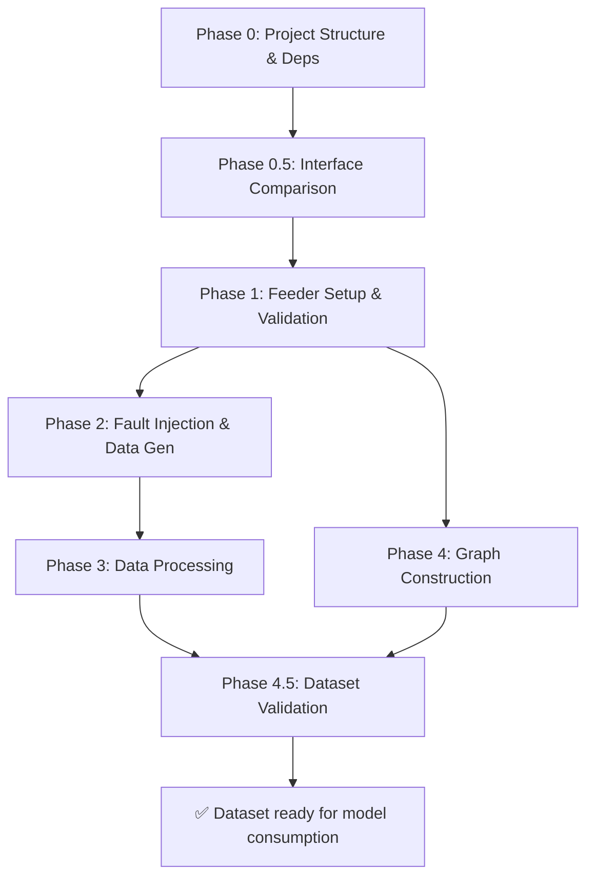

# IEEE 123-Bus Fault Localization — Implementation Plan: Dataset Creation & Validation

Scope: Reproduce the simulation, data generation, graph construction, and validation pipeline from [DATASET.md](file:///home/ubuntu/Fault-Localization/DATASET.md). Model implementation and training are deferred to a separate plan.

## User Review Required

> [!IMPORTANT]
> **Compute budget & Event Count Reconciliation**: 825 scenarios × 100 runs would produce 82,500 fault events, yielding ~3.3M windows (exceeding [BASE]'s 2.5M window target). We avoid premature execution by running a **single-event smoke test** followed by a **5×2 pilot test**. Empirical window counts per event ($W$) from the pilot will be used to back-calculate the exact `RUNS_PER_SCENARIO` $R \approx 2.5\text{M} / (825 \times W)$ (e.g. $R \approx 75 \text{ or } 76$ runs/scenario = ~62,000 fault events). Parallelization (multiprocessing) is included in `runner.py`.

> [!WARNING]
> **IEEE 123-bus feeder files**: We need the standard `.dss` model files. These ship with the OpenDSS distribution. The plan assumes downloading them from the official dss-extensions GitHub repository. Please confirm this is acceptable, or provide the files if you have a local copy.

## Design Decisions & Deferred Scoping

1. **"Green" feeder configuration**: **Deferred.** The default feeder configuration dataset generation, windowing, graph construction, and Phase 4.5 validation will be fully built and validated first. Scaffolding/adaptation for the green feeder configuration will be done in a subsequent phase after the default feeder benchmark is complete.

---

## Proposed Changes

The implementation is organized into **6 phases** (0, 0.5, 1–4, 4.5). Each phase is independently testable before proceeding.

---

### Phase 0 — Project Structure & Dependencies

#### [MODIFY] [pyproject.toml](file:///home/ubuntu/Fault-Localization/pyproject.toml)

Add required dependencies:

```toml
dependencies = [
    "ipykernel>=7.3.0",
    # Simulation — both installed for Phase 0.5 comparison
    "opendssdirect.py>=0.9",
    "NREL-pydss",
    # Data processing
    "numpy>=1.26",
    "pandas>=2.2",
    "scipy>=1.13",
    # Graph & visualization
    "networkx>=3.3",
    "matplotlib>=3.9",
    "seaborn>=0.13",
    # Utilities
    "pyyaml>=6.0",
    "tqdm>=4.66",
    "scikit-learn>=1.5",
    "pytest>=8.0",
]
```

#### [NEW] Project directory structure

```
fault_localization/
├── __init__.py
├── config/
│   ├── __init__.py
│   └── constants.py          # Bus IDs, μPMU locations, fault types, resistances
├── simulation/
│   ├── __init__.py
│   ├── feeder.py             # IEEE 123-bus feeder loader + validation
│   ├── fault_injection.py    # Fault object creation for all 11 types
│   ├── runner.py             # Orchestrator: loop over scenarios × runs
│   └── monitors.py           # μPMU voltage extraction at 25 locations
├── processing/
│   ├── __init__.py
│   ├── windowing.py          # Sliding window extraction
│   ├── normalization.py      # Z-score normalization (train-set fit)
│   ├── labels.py             # Label assignment (26-class)
│   └── splits.py             # 70/15/15 split with leakage prevention
├── graph/
│   ├── __init__.py
│   ├── measured_only.py      # Algorithm 1 from [BASE] — 25-node graph
│   └── edge_attributes.py   # R, X, |Z|, + configurable additional features
├── validation/
│   ├── __init__.py
│   ├── dataset_checks.py     # Statistical validation of generated dataset
│   └── visualization.py      # Voltage sag plots, class distributions, graph viz
└── data/
    └── ieee123/              # Downloaded IEEE 123-bus .dss files

tests/
├── test_feeder.py
├── test_simulation.py
├── test_fault_types.py
├── test_windowing.py
├── test_splits.py
├── test_graph.py
└── test_dataset_validation.py
```

#### [NEW] dataset/ output directory (from DATASET.md §10)

```
dataset/
├── raw_sim/                  # Raw simulation outputs
├── processed/
│   ├── windows/              # Sliding-window tensors [N, S, F]
│   ├── labels.csv
│   ├── metadata.csv
│   ├── edge_index.npy        # PyG-format [2, E]
│   └── edge_attr.npy         # [E, F_edge]
├── splits/
│   ├── train.txt
│   ├── val.txt
│   └── test.txt
├── validation/               # Phase 4.5 outputs (plots, stats)
└── config/
    └── dataset_spec_v1.yaml
```

---

### Phase 0.5 — Simulation Interface Decision: opendssdirect.py vs PyDSS

> [!IMPORTANT]
> The base paper used PyDSS. Before committing to an interface, we perform a structured comparison to ensure faithful reproduction.

#### Comparison criteria

| Requirement | Needed for reproduction? | opendssdirect.py | PyDSS (NREL) |
|---|---|---|---|
| Compile & solve IEEE 123-bus feeder | ✅ | ? | ? |
| Inject `Fault` objects (all 11 types) | ✅ | ? | ? |
| Dynamic / time-series simulation mode | ✅ (1 ms steps) | ? | ? |
| Monitor placement at specific buses | ✅ (25 μPMUs) | ? | ? |
| Extract 3-phase RMS voltage per timestep | ✅ | ? | ? |
| Load multiplier scaling | ✅ | ? | ? |
| Cross-platform (Linux) | ✅ | ? | ? |
| Python 3.12 compatibility | ✅ | ? | ? |

#### Method

1. Install both packages
2. Attempt the same minimal task with each: compile IEEE 123-bus, inject a single LG fault at Bus 7 (R=1Ω), solve for 60 timesteps at 1 ms, extract 3-phase voltage at 3 μPMU buses
3. Compare: API ergonomics, simulation output format, any behavioral differences
4. Check whether [BASE] relies on any PyDSS-specific controller or co-simulation feature
5. **Decision gate**: Document findings and select the interface

#### [NEW] `docs/interface_comparison.md`

Comparison report with findings, decision, and rationale.

---

### Phase 1 — Simulation Environment Setup & Validation

Addresses DATASET.md §11 open items.

#### [NEW] [feeder.py](file:///home/ubuntu/Fault-Localization/fault_localization/simulation/feeder.py)

- Download/embed IEEE 123-bus `.dss` master file and supporting files
- Compile circuit via the chosen interface (from Phase 0.5)
- Run baseline (no-fault) power flow and verify convergence
- Enumerate all buses; verify 25 fault positions and 25 μPMU locations exist
- Extract line impedance data (R, X) per line object for edge attributes

#### [NEW] [constants.py](file:///home/ubuntu/Fault-Localization/fault_localization/config/constants.py)

```python
FAULT_BUSES = [7, 13, 18, 21, 25, 29, 35, 42, 47, 51, 53, 55, 57, 62, 65,
               72, 80, 83, 86, 89, 93, 97, 99, 101, 108]

PMU_BUSES = [1, 6, 13, 18, 25, 26, 33, 35, 36, 45, 47, 54, 60, 69, 75,
             76, 81, 84, 91, 97, 103, 105, 109, 113, 300]

FAULT_TYPES = ["AG", "BG", "CG", "AB", "BC", "CA",
               "ABG", "BCG", "CAG", "ABC", "ABCG"]

FAULT_RESISTANCES = [0.1, 1.0, 10.0]  # Ohms

LOAD_MULTIPLIER_RANGE = (0.5, 1.3)
FAULT_DURATION_MS = 20
SAMPLING_RESOLUTION_MS = 1
WINDOW_LENGTH = 20         # timesteps
WINDOW_STRIDE = 1          # ms
PRE_FAULT_MS = 40
TOTAL_RECORD_MS = 60
RUNS_PER_SCENARIO = 76    # Back-calculated in Stage 2.3 based on pilot window count W (target 2.5M total windows)
NUM_CLASSES = 26           # 25 fault locations + 1 no-fault
```

---

### Phase 2 — Fault Injection & Data Generation

#### [NEW] [fault_injection.py](file:///home/ubuntu/Fault-Localization/fault_localization/simulation/fault_injection.py)

Maps the 11 fault type codes to OpenDSS `Fault` object commands.

> [!NOTE]
> **Provisional mapping — to be validated against OpenDSS documentation and the IEEE 123-bus implementation before use.** The exact command syntax (single-terminal vs. two-terminal `Fault` objects, phase node specifications) will be confirmed through testing during Phase 1 feeder bring-up.

| Fault Category | Types | Key Validation Points |
|---|---|---|
| Line-to-ground (LG) | AG, BG, CG | Single-phase fault to ground — straightforward |
| Line-to-line (LL) | AB, BC, CA | May require two-terminal fault object; phase node syntax TBD |
| Double line-to-ground (LLG) | ABG, BCG, CAG | Ground connection method TBD |
| Three-phase | ABC, ABCG | Grounded vs. ungrounded distinction TBD |

Each fault type individually tested to confirm distinct voltage signatures before batch generation.

#### [NEW] [monitors.py](file:///home/ubuntu/Fault-Localization/fault_localization/simulation/monitors.py)

- Place monitors at each of the 25 μPMU buses
- Record 3-phase RMS voltage magnitudes (V1, V2, V3) at 1 ms resolution
- Extract 60 ms window: 40 ms pre-fault + 20 ms fault-active
- Save per-run raw data as compressed NumPy arrays

#### [NEW] [runner.py](file:///home/ubuntu/Fault-Localization/fault_localization/simulation/runner.py)

Main simulation orchestrator, executed in **four explicit stages**:

##### Stage 2.1: Single-Event Smoke Test
- Execute 1 event (1 bus, 1 fault type, 1 resistance, 1 run).
- Visually inspect raw 3-phase voltage waveform plot (40 ms pre-fault + 20 ms fault-active) to confirm fault onset, voltage sag, and OpenDSS monitor accuracy.

##### Stage 2.2: 5×2 Pilot Test & Window Count Verification
- Execute 10 events (5 scenarios × 2 runs).
- Pass pilot outputs through `windowing.py` to empirically measure $W$, the exact number of valid sliding windows produced per fault event (confirming 40 vs 41).

##### Stage 2.3: Event-Count Reconciliation & Run-Count Back-Calculation
- Target total dataset size per [BASE]: **2,500,000 windows** (70% train = 1,750,000; 15% val = 375,000; 15% test = 375,000).
- Back-calculate required runs per scenario $R$:
  $$\text{Total Events } E = \frac{2,500,000}{W}$$
  $$R = \frac{E}{825 \text{ scenarios}} = \frac{2,500,000}{825 \times W}$$
  - *Example*: If empirical $W = 40$, $E = 62,500$ events $\implies R \approx 75.76 \rightarrow 76$ runs/scenario (total $825 \times 76 = 62,700$ events $\implies 2,508,000$ windows).
  - *Example*: If empirical $W = 41$, $E = 60,975$ events $\implies R \approx 73.9 \rightarrow 74$ runs/scenario (total $825 \times 74 = 61,050$ events $\implies 2,503,050$ windows).
- Update `constants.py` and `dataset_spec_v1.yaml` with reconciled `RUNS_PER_SCENARIO = R` **before** starting full generation.

##### Stage 2.4: Full Dataset Generation
- Execute full pass using reconciled $R$ (e.g. ~75 runs instead of 100 runs per scenario).
- Loop structure:
```python
for fault_bus in FAULT_BUSES:           # 25
    for fault_type in FAULT_TYPES:       # 11
        for resistance in RESISTANCES:   # 3
            for run_id in range(RECONCILED_RUNS):  # ~75 runs (back-calculated)
                load_mult = uniform(0.5, 1.3)
                seed = deterministic_seed(fault_bus, fault_type, resistance, run_id)
                # 1. Compile feeder & apply load multiplier
                # 2. Solve pre-fault steady state (40ms) & inject fault at t=40ms
                # 3. Solve dynamics for 20ms & record 25 μPMU voltages
                # 4. Save raw output NPZ
```

- `multiprocessing` support for parallel scenario execution.
- Progress tracking with `tqdm` and checkpoint/resume support.
- Deterministic seeding per (scenario, run) tuple.

**Output**: `dataset/raw_sim/{fault_bus}_{fault_type}_{resistance}_{run_id}.npz` — shape `[25, 60, 3]`

---

### Phase 3 — Data Processing Pipeline

#### [NEW] [windowing.py](file:///home/ubuntu/Fault-Localization/fault_localization/processing/windowing.py)

- Input: raw `[25, 60, 3]` arrays per fault event
- Sliding window: length S=20, stride 1

> [!NOTE]
> **Window count to be confirmed against the paper.** Mathematical derivation: 60 − 20 + 1 = 41. DATASET.md §4 states "40 overlapping windows per fault event." This discrepancy must be resolved by checking the paper's exact extraction procedure before implementation.

- Output per window: tensor of shape `[N=25, S=20, F=3]`
- Generates `window_id` for cross-referencing

#### [NEW] [labels.py](file:///home/ubuntu/Fault-Localization/fault_localization/processing/labels.py)

- 26-class labels: Class 0 (no fault) + Classes 1–25 (fault at each bus, sorted order)
- Outputs `labels.csv`: `window_id, fault_bus, label`
- Outputs `metadata.csv`: `window_id, run_id, fault_bus, fault_type, resistance, load_multiplier, seed`

#### [NEW] [splits.py](file:///home/ubuntu/Fault-Localization/fault_localization/processing/splits.py)

- 70/15/15 random split at the **fault-event level** (not window level)
- All overlapping windows from the same fault event stay in the same split (no leakage)
- Stratified by fault location for class balance
- Outputs `train.txt`, `val.txt`, `test.txt`
- Fixed random seed

#### [NEW] [normalization.py](file:///home/ubuntu/Fault-Localization/fault_localization/processing/normalization.py)

- Z-score normalization: compute mean/std from **training set only**
- Save normalization statistics for inference-time use

---

### Phase 4 — Graph Construction

#### [NEW] [measured_only.py](file:///home/ubuntu/Fault-Localization/fault_localization/graph/measured_only.py)

Implements [BASE] Algorithm 1 for the 25-node measured-only graph:

1. Parse IEEE 123-bus feeder topology (line connectivity)
2. Identify all 25 μPMU nodes
3. Classify each μPMU as single-phase, two-phase, or three-phase
4. Build edges:
   - Three-phase μPMUs: connected along backbone by electrical proximity
   - Single/two-phase μPMUs: connected to nearest three-phase μPMU
   - Loop handling: if between two three-phase μPMUs, connect to both
5. Output: `edge_index.npy` (PyG format `[2, E]`), undirected

#### [NEW] [edge_attributes.py](file:///home/ubuntu/Fault-Localization/fault_localization/graph/edge_attributes.py)

**Output**: `edge_attr.npy` shape `[E, F_edge]` where `F_edge` is configurable.

Default features (always computed):
- **R**: total resistance along the path
- **X**: total reactance along the path
- **|Z|**: impedance magnitude √(R² + X²)

Optional features (stored, selectable at model-load time):
- Physical line length
- Susceptance (B)
- Phase configuration (encoded)

```python
EDGE_FEATURES = ["R", "X", "Z_mag"]           # default
# EDGE_FEATURES = ["R", "X", "Z_mag", "length", "B"]  # extended
# F_edge = len(EDGE_FEATURES)
```

---

### Phase 4.5 — Dataset Validation

> [!IMPORTANT]
> This phase is the final gate. The dataset is considered ready for model consumption only after all checks pass.

#### [NEW] [dataset_checks.py](file:///home/ubuntu/Fault-Localization/fault_localization/validation/dataset_checks.py)

| Check | Expected | Action if failed |
|---|---|---|
| Total windows generated | Matches expected count (per paper) | Investigate windowing logic |
| Class distribution | ~50% no-fault, ~2% per fault bus | Re-examine label assignment |
| Feature value ranges (pre-normalization) | Voltages in plausible kV range | Check simulation output |
| Feature statistics (post-normalization) | Train set: μ≈0, σ≈1 | Check normalization code |
| No NaN/Inf in tensors | Zero NaN/Inf | Fix simulation divergence |
| Split sizes | 70/15/15 ± rounding | Check split logic |
| No window leakage | Zero shared event IDs across splits | Fix split logic |
| Graph connectivity | 25 nodes, connected, no isolated nodes | Fix graph construction |
| Edge attribute ranges | R, X > 0 for all edges | Check impedance extraction |

#### [NEW] [visualization.py](file:///home/ubuntu/Fault-Localization/fault_localization/validation/visualization.py)

Outputs saved to `dataset/validation/`:

1. **Voltage sag plots**: 3–5 representative fault events, 3-phase voltage across 60 ms. Verify visible pre-fault → fault transition at t=40ms.
2. **Fault signature comparison**: Overlay voltage profiles for different fault types at the same bus.
3. **Class distribution histogram**: Bar chart across all 26 classes.
4. **Feature distribution**: Raw voltage histograms + post-normalization distribution.
5. **Graph topology**: NetworkX plot of the 25-node measured-only graph with bus ID labels and edge weights.
6. **Split balance**: Class distribution per split to verify stratification.

---

## Verification Plan

### Automated Tests

| Phase | Test | Command |
|---|---|---|
| 0 | Dependencies install cleanly | `uv sync` |
| 0.5 | Interface comparison complete, decision documented | Review `docs/interface_comparison.md` |
| 1 | Feeder loads, no-fault power flow converges, all bus IDs present | `python -m pytest tests/test_feeder.py` |
| 2 | Single scenario produces correct output shape `[25, 60, 3]` | `python -m pytest tests/test_simulation.py` |
| 2 | All 11 fault types produce distinct voltage signatures | `python -m pytest tests/test_fault_types.py` |
| 3 | Windowing produces correct count and shapes | `python -m pytest tests/test_windowing.py` |
| 3 | No window leakage across splits | `python -m pytest tests/test_splits.py` |
| 4 | Graph has 25 nodes, connected, edge attrs shape `[E, F_edge]` | `python -m pytest tests/test_graph.py` |
| 4.5 | All dataset validation checks pass | `python -m pytest tests/test_dataset_validation.py` |

### End-to-End Pilot

Before full generation:
1. Run single-event smoke test (Stage 2.1) & visually inspect waveform.
2. Run 5 scenarios × 2 runs as a mini pilot (Stage 2.2).
3. Measure empirical window count per event ($W$) and back-calculate reconciled runs $R$ and total events $E = 2.5\text{M}/W$ (~61,000–62,700 events).
4. Verify full pipeline: simulation → windowing → normalization → splits → graph → validation.
5. Estimate compute time for full reconciled generation pass ($E$ events).

---

## Execution Order



> [!NOTE]
> Phases 2 and 4 can proceed in parallel after Phase 1 — graph construction depends only on feeder topology, not simulation data.

---

## Deliverables

At the end of this plan, the project will have:

| Deliverable | Location |
|---|---|
| Validated IEEE 123-bus simulation environment | `fault_localization/simulation/` |
| Reconciled raw fault-event recordings (~61,000–62,700 events, 2.5M windows) | `dataset/raw_sim/` |
| Sliding-window tensors `[N, S, F]` (~2.5M windows total) | `dataset/processed/windows/` |
| Labels (26-class) + metadata | `dataset/processed/labels.csv`, `metadata.csv` |
| Train/val/test splits (1.75M / 375k / 375k, no leakage) | `dataset/splits/` |
| Measured-only graph (25 nodes) | `dataset/processed/edge_index.npy` |
| Configurable edge attributes `[E, F_edge]` | `dataset/processed/edge_attr.npy` |
| Dataset validation report + plots | `dataset/validation/` |
| Machine-readable spec | `dataset/config/dataset_spec_v1.yaml` |
| Interface comparison report | `docs/interface_comparison.md` |
| Full test suite | `tests/` |
